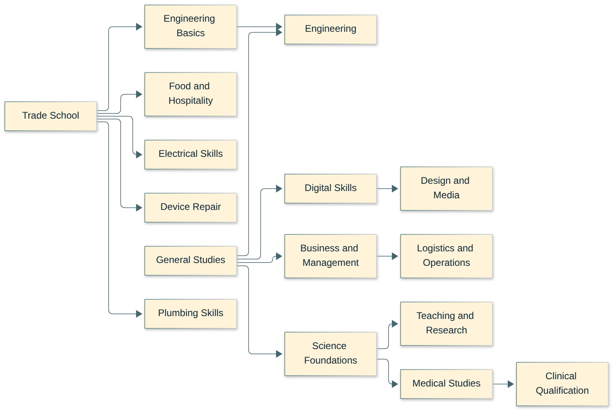
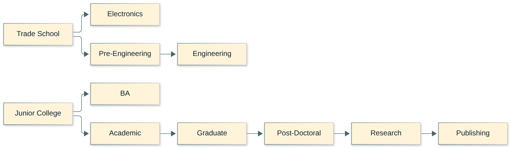
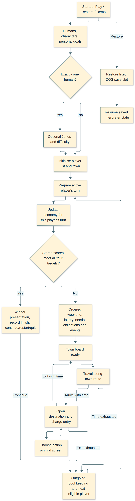
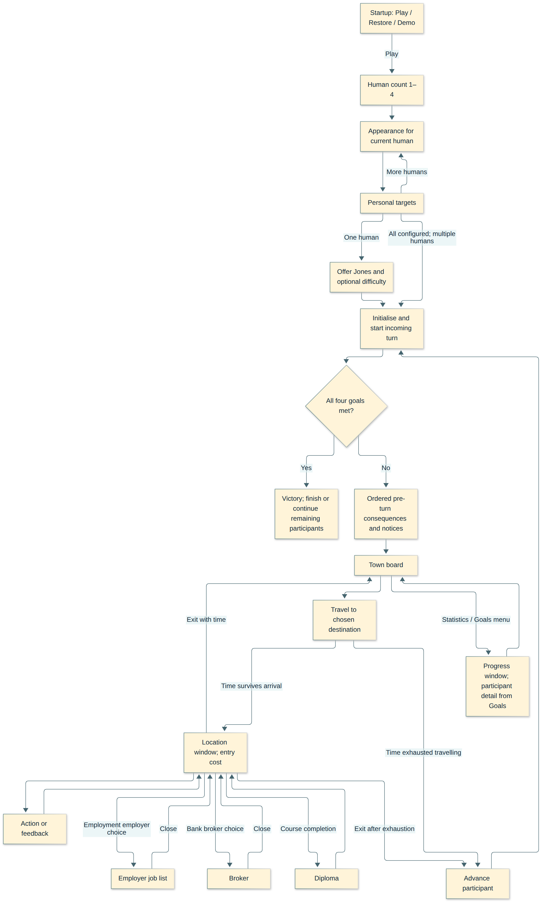
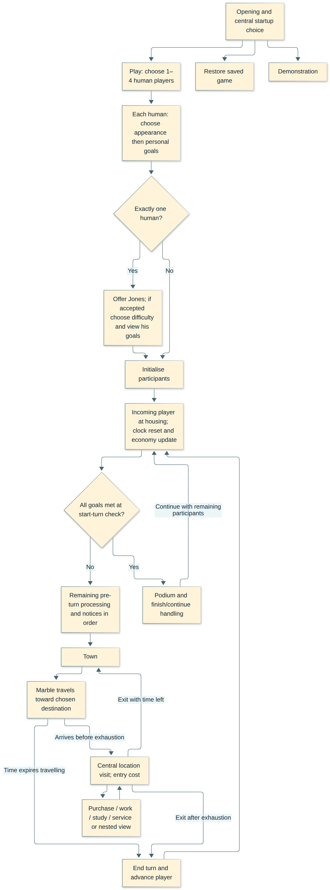
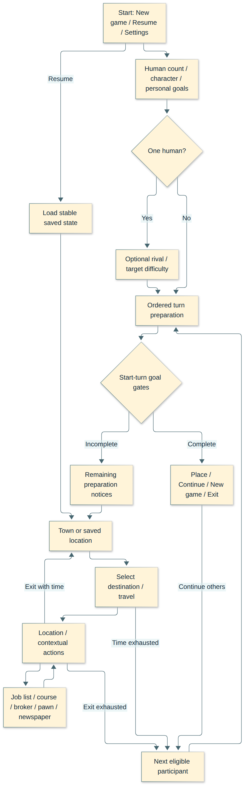
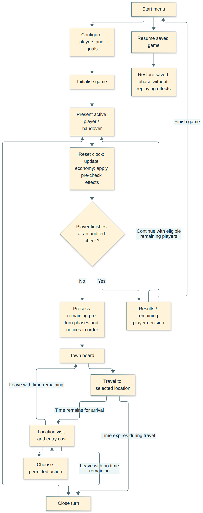

# Rendered Mermaid diagrams

Rendered directly from the documentation source. These are diagrams, not game screenshots. Original references and earlier proposals retain their own evidence/status; the career graph is a current proposal.

Open the SVG for full-resolution zoom, or use the offline [HTML gallery](../../artifacts/diagrams/index.html). [Rebuild instructions](../../tools/docs/README.md).

## Proposed course graph

**Current career proposal — details unapproved.** From [Career and town graph v2](../../docs/planning/career-and-town-graph-v2.md).

[Open SVG](../../artifacts/diagrams/planning--career-and-town-graph-v2.svg) · [PNG](../../artifacts/diagrams/planning--career-and-town-graph-v2.png)

## Education: the two original starting branches

**Original-game reference.** From [Original game: content and progression catalogue](../../docs/original-game/content-progression.md).

[Open SVG](../../artifacts/diagrams/original-game--content-progression.svg) · [PNG](../../artifacts/diagrams/original-game--content-progression.png)

## Whole-game journey

**Original-game reference.** From [Original game flow and rule contract](../../docs/original-game/game-flow-and-rule-contract.md).

[Open SVG](../../artifacts/diagrams/original-game--game-flow-and-rule-contract.svg) · [PNG](../../artifacts/diagrams/original-game--game-flow-and-rule-contract.png)

## Flow and ownership of the central area

**Original-game reference.** From [Original screen reconstruction and interaction flow](../../docs/original-game/screen-reconstruction.md).

[Open SVG](../../artifacts/diagrams/original-game--screen-reconstruction.svg) · [PNG](../../artifacts/diagrams/original-game--screen-reconstruction.png)

## Original flow between screens

**Original-game reference.** From [Original game: town and screen layout](../../docs/original-game/town-and-screen-layout.md).

[Open SVG](../../artifacts/diagrams/original-game--town-and-screen-layout.svg) · [PNG](../../artifacts/diagrams/original-game--town-and-screen-layout.png)

## Screen flow

**Earlier planning draft — see modern-direction review for amendments.** From [2.0 draft: preserve the game, renew the town](../../docs/planning/2.0-draft-specification.md).

[Open SVG](../../artifacts/diagrams/planning--2.0-draft-specification.svg) · [PNG](../../artifacts/diagrams/planning--2.0-draft-specification.png)

## Proposed overall journey

**Earlier planning draft — see modern-direction review for amendments.** From [Game flow and layout outline](../../docs/planning/flow-and-layout-outline.md).

[Open SVG](../../artifacts/diagrams/planning--flow-and-layout-outline.svg) · [PNG](../../artifacts/diagrams/planning--flow-and-layout-outline.png)

