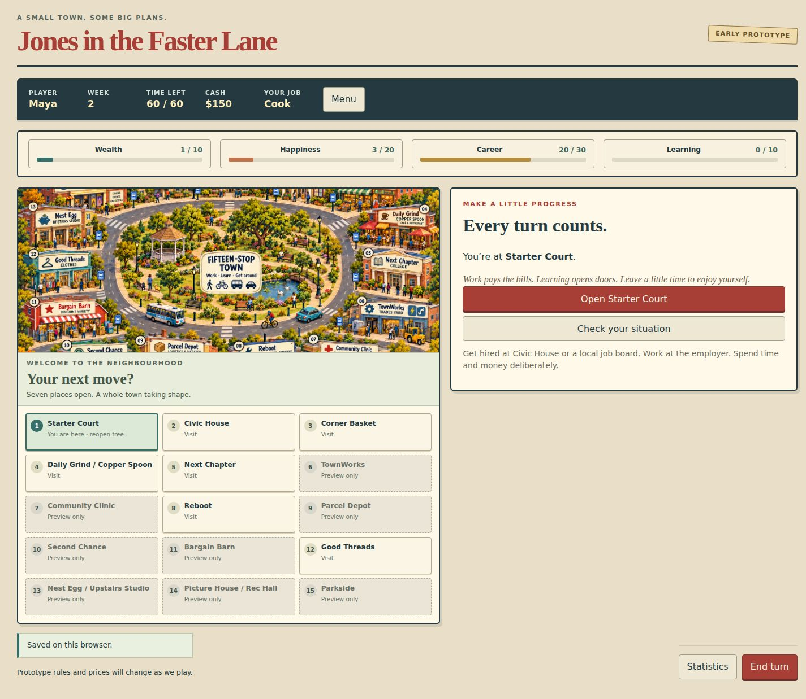

# Bounded prototype v1

2026-10-17. The owner's “kick along,” following the reviewed baseline recommendation, authorises this bounded prototype (D024). The baseline is editable: implementation is permission to test the proposed rules, not approval of final balance, a complete remake or a public release.

The plain TypeScript simulation is implemented and exercised through actual action traces. A React interface now calls the same simulation for the seven active places. The browser has been checked through hiring, work, food, turn advance, resume and an exported-text/file-import round trip. A family playtest has not yet been performed.

This document records implementation status. The [first-playable scope](../planning/first-playable-scope.md) defines the boundary, the [Learning proposal](../planning/learning-goal-proposal.md) explains deliberate progression changes, and the [whole-pack review](../planning/whole-pack-review-v1.md) explains their planning context. Earlier planning-only labels describe those documents' historical status; D024 and this implementation record supersede the earlier prohibition on starting this bounded work.

## Run and reproduce

Use Node.js **24.12.0 or later** and npm. No database, service account or backend is required.

```sh
npm ci
npm run check
npm run trace
npm run trace -- --write
npm run dev
npm run build
```

`check` runs TypeScript checking and the simulation tests. Tests run with Node's test isolation disabled so the host actually executes and reports the named TypeScript tests. `trace` executes an opening scenario and four campaign fixtures, printing their summary. Adding `--write` regenerates the committed JSON traces under [headless-v1](../../artifacts/prototype/headless-v1/summary.json). The trace runs in a console. `dev` starts the local Vite browser preview, normally at http://127.0.0.1:5173/; `build` typechecks and creates a static bundle in ignored `dist/`.

## Implemented coverage

| Area | Headless implementation | Browser status |
| --- | --- | --- |
| Opening and goals | Audited applicable fresh allocation; preset Wealth 10 / Happiness 20 / Career 30 / Learning 10; incoming-turn finish check | Solo start/resume, four-goal explanations and finish display wired |
| Town and transport | Fifteen-stop ring; seven active destinations; walk/bike/bus/car quotes, arrival cost, ownership and per-turn car charge | Illustrated town reference, named destination buttons, quote selection and visit panels wired |
| Jobs | Six jobs, civic/local application access, openings and rejection memory, raises, workplace/clothing checks, warnings/dismissal, prorated work/pay | Civic/local job lists, requirements and work results wired |
| Progression | Actual successful work time, Learning and growth allowance, work-history steps, one ten-lesson Trade School qualification | Course progress, graduation notice and Learning explanation wired; illustrated diploma deferred |
| Purchases | Food, three clothing grades, bike, car and fridge; ownership and relevant purchase bonuses | Shop actions and home/statistics ownership text wired |
| Incoming turn | Applicable ordered food/spoilage/hunger/doctor effects, stock/clothing decay, rent access, economy/job shocks, recovery and finish | Ordered notices and needs guidance wired |
| Rent/recovery | Stored contract, due/extension access, arrears and garnishment; C20 temporary clothing fallback | Separate rent counter and recovery notice wired |
| Economy | Eight persisted layers; floppy reading bounds; explicit C07/C08 choices; seeded rule draws and contracted wages | Live shop/job quotes wired; no extra economy dashboard |
| Action feedback | Effects committed once; notices acknowledged without replaying effects; duplicate/out-of-order request guards | Native modal focus, acknowledgement and action guards wired; representative keyboard checks passed |
| Saves | Stable versioned JSON export/import with strict validation and deterministic continuation | Local checkpoint, resume, portable JSON/text export and file import wired |
| Multiple actors | One-to-four actor state and controlled rotation fixtures | Solo interface first; shared-device setup/handover and AI deferred |

The ordinary work-first and Trade School → Butcher routes both reach a four-goal finish in executed fixtures. Transport, purchases, rent, setbacks and supported save boundaries also have controlled tests; a campaign need not purchase every item before winning. Representative browser layout and keyboard checks are recorded below. Full accessibility/touch-device review and family comprehension remain to test.

## Simulation boundaries and API

- [types.ts](../../src/simulation/types.ts): state, actions, intents and transition types.
- [content.ts](../../src/simulation/content.ts): stable destinations, jobs and items.
- [engine.ts](../../src/simulation/engine.ts): new-game allocation, trip quotes and action dispatch.
- [turns.ts](../../src/simulation/turns.ts): ordered incoming and outgoing processing.
- [selectors.ts](../../src/simulation/selectors.ts): read-only derived Learning, scores and goal checks.
- [economy.ts](../../src/simulation/economy.ts) and [rng.ts](../../src/simulation/rng.ts): economy and reproducible rule draws.
- [save.ts](../../src/simulation/save.ts): supported stable snapshot validation and serialization.

The public entry points are `createGame(options)`, `quoteTrip(state, destination, mode)` and `dispatch(state, { id, action })`. `dispatch` returns `{ state, accepted, message }` and preserves its input state. The caller adopts the returned state even for a refusal: some legal attempts consume time, randomness or a request ID and may produce a notice. A stale or out-of-order request is rejected without replaying the action. A fresh request uses `state.sequence + 1`; do not reuse an old request ID after restoring.

```ts
let state = createGame({ seed: 42 });
const result = dispatch(state, {
  id: state.sequence + 1,
  action: { type: 'travel', destination: 'hospitality', mode: 'walk' },
});
state = result.state;
// Read the result, then acknowledge committed feedback without repeating travel.
while (state.notices.length > 0) {
  state = dispatch(state, {
    id: state.sequence + 1,
    action: { type: 'acknowledge' },
  }).state;
}
```

The example omits presentation; a browser should let the player read each notice. During notices, ordinary actions are blocked. Incoming effects are applied atomically before their notices are displayed. Acknowledgement removes feedback only; it does not rerun a salary, course award, recovery grant or turn. Reading selectors, rendering and quoting travel do not consume rule randomness or resources.

## Versions, randomness and supported data

Snapshots use `schema: 1`, `rules: 'prototype-0.1'` and `content: 'town-0.1'`. Import supports these exact versions, not implicit migration. Snapshots preserve the current PRNG state, actors, sequence, turn, economy and relevant flags. Export requires no pending notices; importing does not start a new turn, issue rewards or move a player home. Unsupported fields/IDs, malformed quantities, inconsistent course completion and oversized documents are rejected. The importer returns a new validated state; callers must validate before replacing an existing checkpoint.

General quantities and lifetime counters are bounded at **1,000,000,000**, with narrower field-specific bounds, such as remaining time 0–60, Happiness 0–100 and goals 10–100 in tens. JSON documents are capped at 1 MiB and actor counts at four. These are deliberate prototype data limits, not legacy overflow emulation.

Rule randomness uses a uint32 linear congruential generator, `x = 1664525*x + 1013904223` modulo 2³², with rejection sampling for inclusive integer ranges. Input seed0 and persisted LCG state0 are both valid and distinct from1. This is the successor's reproducible stream, **not** the original DOS generator or a promise of identical original draw outcomes. Presentation must not draw from it.

`economyMode: 'neutral-fixture'` fixes the economy to neutral readings for diagnostic tests. It is clearly marked in artifacts and is not evidence about live economic balance. Normal creation defaults to `live`.

## Executed journeys and their limits

The [generated summary](../../artifacts/prototype/headless-v1/summary.json) records seed 42 for the same scripted policies under live and neutral economy modes:

| Policy | Live finish week | Neutral-fixture finish week | Reached role |
| --- | --- | --- | --- |
| Work-first | 9 | 9 | Venue Manager, without a qualification |
| Trade School | 16 | 22 | Butcher, with Trade School |

These are deterministic examples of reachability under the chosen policies. They do not measure human session length, establish equal route strength, or prove optimal play. The longer Butcher trace does not by itself imply education is inherently slower; the scripts choose travel, study, work and recovery actions. A different policy, seed or tuning can change the result. Tests also restore a supported checkpoint and compare subsequent outcomes rather than substituting the earlier analytical cash worksheets for a running simulation.

## Deliberate limits and next evidence

This is a successor subset based on the audit, not complete original-game equivalence. It includes proposed Learning/work-growth and C20 recovery changes. It omits the full weekend/event catalogue, lotteries, tickets, appliance events, pawn/broker/loans, full housing, additional courses/employers, recruited offers, useful phone/laptop features and remote work. Eight destinations are preview-only. There is no AI policy, multiplayer interface, leaderboard, account, backend or public deployment.

The code and new presentation use original analytical work and newly authored assets; original game bundles, extracted artwork/audio and decompiled game source remain local and ignored. No application licence or release name is settled.

Next, run the family review on the local prototype, record assistance and session lengths, and tune explanations and pacing before expanding content or modes. The current board uses the existing original generated concept image as decoration with separate named controls; interactive illustrated storefronts, clerk portraits, animation/audio and full production art remain future visual iterations.


## Browser persistence and QA

[App.tsx](../../src/App.tsx) renders the prototype and dispatches intents; [browser-save.ts](../../src/browser-save.ts) wraps validated engine JSON with browser format/version1 and town/visit/jobs selection. Local storage uses one current checkpoint, written only after notices are acknowledged. A pending outcome keeps the previous checkpoint. Resume restores the same place, time, rule state and selected stable view without recharging arrival. Headless JSON imports default to the town view; the browser UI accepts solo games only. Import validates before confirming replacement; malformed files preserve the running game. Storage failure is visible and portable export remains available. Device/browser storage can still be cleared by the user.

Export exposes selectable JSON text as well as a Download JSON control. The in-app browser's automated download event did not complete, so delivery of a downloaded file is not claimed as verified. The export text was read through the UI, written to a local test file and successfully reimported through the actual file chooser/confirmation, restoring week2, cash150, Cook and60 time. Pure save/import and view-validation tests supplement that browser check.

Browser checks on2026-10-17: fresh start; walk quote/arrival; local Cook application; one paid shift; hamburger purchase; next turn/home reset; resume in a reopened tab; read-only Learning explanations; Escape dismissal; export text and file import. Actual layouts at1440,1024 and375 pixels had no horizontal overflow and all mounted buttons were at least44 pixels high. Narrow-width checks do not claim a finished phone design or a physical touch-device test. The final page reported no browser console errors. The local preview process was restarted after a connection interruption; persisted state survived the new tab.



The screenshot is an actual prototype screen, not the earlier illustrative wireframe. Setup/finish, advanced job/course flows and every edge fixture are not all browser-automated; headless tests cover their stated rule boundaries. No public deployment was performed. Dependencies are pinned in the lockfile; React/Vite release context was checked against [React versions](https://react.dev/versions) and [Vite releases](https://vite.dev/releases), with exact available versions verified from npm registry metadata.

Verification at handoff: `npm run check` passes58 named tests and strict TypeScript checking; `npm run build` succeeds. Regenerating all six trace JSON files is byte-for-byte identical. The import view parser rejects coercible non-string fields; imported supported work-growth boundaries remain saveable. File import tracks game replacement while reading so a newly started game still requires replacement confirmation.
