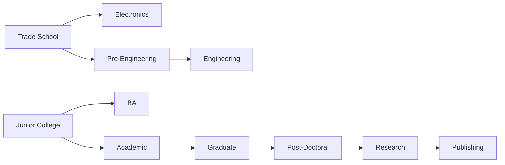

# Original game: content and progression catalogue

Research date: 2026-10-15. **Script findings** from the published DOS floppy **1.000.060** decompilation, pinned to `870a8015b689474484bf3d8b41416956d4315432`. This is a reference to refine later, not an approved new-game design. No runtime verification is implied.

## Education: the two original starting branches

The university defines 11 qualifications. Trade School and Junior College are available without a completed prerequisite. A completed qualification disappears from the selectable list, and newly eligible successors appear. The following names normalize the script instance names; the [decoded book-label table](asset-catalogue-notes.md#precise-course-label-transcription-targets) records the actual graphical wording. In particular, qualification 15 (`ba`) is shown as “Bus. Admin.” and 16 as “Academic”. IDs allow unambiguous cross-reference to jobs.

| ID | Course / qualification | Required completed qualification | Direct progression / selected job relevance |
| --- | --- | --- | --- |
| 10 | Trade School | None | Electronics or Pre-Engineering; Assembly Worker and Butcher |
| 11 | Electronics | Trade School (10) | Electronic's Repair; one of two requirements for Socket City Manager |
| 12 | Pre-Engineering | Trade School (10) | Engineering; Machinist's Helper |
| 13 | Engineering | Pre-Engineering (12) | Machinist; combined with academic/business studies for upper factory jobs |
| 14 | Junior College | None | BA or Academic; many clerical and lower-management jobs |
| 15 | BA | Junior College (14) | Business management roles; Investment Broker also requires Academic |
| 16 | Academic | Junior College (14) | Graduate; Teacher; second qualification for Investment Broker |
| 17 | Graduate | Academic (16) | Post-Doctoral |
| 18 | Post-Doctoral | Graduate (17) | Research |
| 19 | Research | Post-Doctoral (18) | Publishing; Professor |
| 20 | Publishing | Research (19) | End of academic branch |

[View rendered diagram (PNG)](../../artifacts/diagrams/original-game--content-progression.png) · [Zoomable SVG](../../artifacts/diagrams/original-game--content-progression.svg) · [All diagrams](../diagrams/README.md)

Enrollment is a separate purchase with an economy-adjusted base cost of 50; it is not a charge per attendance. The player then selects a course and attends repeatedly at six time units per session. Standard graduation requires ten units of attendance. The complete encyclopedia/dictionary/atlas set grants one extra credit; a computer grants another, recalculated at start of turn. These lower the effective attendance requirement to nine or eight. The screen shows remaining attendance; graduating opens a diploma presentation and increases education progress and future work-development allowances. Enrollment count is checked against completed and active courses, so the original tracks permissions to start courses rather than charging separately at every lesson. [University][university], [Educational goods][goods], [equipment credits][startturn].

The website package bytecode now independently confirms all eleven prerequisite records and the enrollment, attendance and graduation paths. The [detailed education trace](../rules-audit/education.md) separates paid enrollment permissions, active-course progress, turn-start equipment credits and completed degrees. A lesson awards its full increment even with only one time unit left; spending all 60 blocks attendance. Graduation grants +5 happiness and +5 each to dependability, education credit and experience credit, then sets education-goal progress to `1 + 9 × completed degrees`. These are package findings; narrow runtime checks remain pending.

The academic ladder is more granular than a single university-degree upgrade. Conversely, the screen stays small by showing eligible unfinished courses only. Many useful career paths require both starting branches; a high-level engineering job can require Engineering plus Junior College or BA.

## Employment: what the lists actually offer

There are **37 employer-specific menu entries across nine employers**. The agency is a navigation point for these lists; it does not supply a separate employer career. The following table records all entries, including the repeated occupations with different employers, wages, and thresholds.

**How to read the numbers:** wage is the script's base hourly amount, before economy adjustment; offered wages fluctuate. Exp is minimum experience. Dep is the declared dependability threshold; a declared value of 10 is specially treated as a zero threshold in `qualify`, while other declared values are literal. Course IDs refer to the table above and `+` means both are needed. Clothing is the job's required work clothing, not an extra education requirement. Shared defaults have been expanded. These qualification numbers are not all necessarily exposed to players as exact UI statistics. [Job qualification and wage/raise handling][employment], [work eligibility][work].

| Employer | Job | Base $/hour | Exp | Dep | Courses | Work clothing |
| --- | --- | ---: | ---: | ---: | --- | --- |
| Z-Mart | Clerk | 4 | 10 | 10 | None | Casual |
| Z-Mart | Assistant Manager | 6 | 20 | 20 | None | Dress |
| Z-Mart | Manager | 7 | 30 | 30 | 14 | Business suit |
| Monolith Burgers | Cook | 4 | 0 | 10 | None | Casual |
| Monolith Burgers | Clerk | 5 | 10 | 20 | None | Casual |
| Monolith Burgers | Assistant Manager | 6 | 20 | 30 | None | Casual |
| Monolith Burgers | Manager | 7 | 30 | 40 | 14 | Dress |
| QT Clothing | Salesperson | 7 | 30 | 30 | None | Dress |
| QT Clothing | Assistant Manager | 9 | 40 | 40 | 14 | Business suit |
| QT Clothing | Manager | 12 | 50 | 50 | 15 | Business suit |
| Socket City | Salesperson | 5 | 20 | 30 | None | Dress |
| Socket City | Electronic's Repair | 11 | 40 | 40 | 11 | Casual |
| Socket City | Manager | 14 | 40 | 40 | 14 + 11 | Business suit |
| Hi-Tech U | Janitor | 4 | 10 | 10 | None | Casual |
| Hi-Tech U | Teacher | 11 | 40 | 50 | 16 | Dress |
| Hi-Tech U | Professor | 20 | 50 | 60 | 19 | Dress |
| Factory | Janitor | 7 | 30 | 30 | None | Casual |
| Factory | Assembly Worker | 8 | 30 | 30 | 10 | Casual |
| Factory | Secretary | 9 | 40 | 40 | 14 | Dress |
| Factory | Machinist's Helper | 10 | 40 | 40 | 12 | Casual |
| Factory | Executive Secretary | 18 | 50 | 50 | 15 | Business suit |
| Factory | Machinist | 19 | 50 | 50 | 13 | Casual |
| Factory | Department Manager | 22 | 60 | 60 | 14 + 13 | Business suit |
| Factory | Engineer | 23 | 60 | 60 | 13 + 14 | Business suit |
| Factory | General Manager | 25 | 70 | 70 | 15 + 13 | Business suit |
| Bank | Janitor | 6 | 20 | 20 | None | Casual |
| Bank | Teller | 10 | 40 | 40 | 14 | Dress |
| Bank | Assistant Manager | 14 | 50 | 50 | 15 | Business suit |
| Bank | Manager | 19 | 60 | 60 | 15 | Business suit |
| Bank | Investment Broker | 22 | 70 | 70 | 15 + 16 | Business suit |
| Black’s Market | Janitor | 5 | 10 | 10 | None | Casual |
| Black’s Market | Checker | 8 | 20 | 20 | None | Casual |
| Black’s Market | Butcher | 12 | 30 | 30 | 10 | Casual |
| Black’s Market | Assistant Manager | 15 | 40 | 40 | 14 | Dress |
| Black’s Market | Manager | 18 | 50 | 50 | 15 | Business suit |
| Rent Office | Groundskeeper | 6 | 20 | 20 | None | Casual |
| Rent Office | Apartment Manager | 8 | 30 | 30 | 14 | Casual |

Evidence for each employer list: [Z-Mart][discountJobs], [Monolith Burgers][fastFoodJobs], [QT Clothing][clothingJobs], [Socket City][applianceJobs], [Hi-Tech U][universityJobs], [Factory][factoryJobs], [Bank][bankJobs], [Black's Market][marketJobs], [Rent Office][rentJobs]. Job titles have had layout filler removed; spelling follows the menu where available.

### Progression and failure are part of the content

Qualifying is not an automatic hire: the application also rolls an opening/chance check, with Cook specially bypassing that random check. A rejection can name education, experience, work history, or no opening. A failed opening can block another attempt at that same job during the turn. Reapplying for the current employer/occupation requests a wage adjustment; feedback distinguishes requesting less, requesting the same wage, receiving a raise, and a refused increase. [Employment][employment].

Actual Work is a separate action at the employer. Work increases experience and dependability subject to occupation/education-related ceilings. Appropriate clothes and adequate work history matter; the original has warnings and firing as well as promotions. This makes study, earning, clothing replacement, and moving between employers interdependent. Detailed shift arithmetic is in the [existing action audit](../rules-audit/time-and-actions.md). [Work script][work].

## Purchases: original menu pools

These are menu catalogues, not assertions that every product has an audited effect. Unless stated otherwise, quoted prices below are **script base prices** before economic adjustment, not a fixed in-game price list.

| Source | Original content pool | What the reference establishes |
| --- | --- | --- |
| Black's Market | Food for 1 / 2 / 4 Weeks (base 55 / 100 / 190); 10 Lottery Tickets; Newspaper | Bulk food is bought in weekly units. Newspaper is a separate presentation. [Storage/spoilage is now audited](../rules-audit/food-and-housing.md); lottery probabilities remain open. |
| Monolith Burgers | Hamburgers, Cheeseburger, Astro Chicken, Fries, Shakes, Colas | Distinct menu items with illustrations; [meal/drink bonuses share two active-turn latches](../rules-audit/fast-food-bonuses.md); purchase order matters. Stored-food and immediate-effect item types differ. |
| QT Clothing | Business Suit (295), Dress Clothes (125), Casual Clothes (73) | Three clothing grades; requirements differ between jobs. |
| Socket City | Refrigerator (876), Freezer (513), Stove (570), Color TV (525), VCR (333), Stereo (412), Microwave (330), Hot Tub (1255), Computer (1599) | Nine appliance/electronic purchase rows. The computer participates in study credits. |
| Z-Mart | Refrigerator (650), Stove (490), Stereo (450), Color TV (349), Black & White TV (110), Microwave (220), VCR (250), Casual Clothes (35), Dress Clothes (90), Baseball Tickets (45), Theatre Tickets (30), Concert Tickets (40), Encyclopedia (475), Dictionary (70), Atlas (55), Dog Food (18), 8-Track Player (75), Works of Capote (100) | **Six drawn from eighteen each turn**, not eighteen permanent rows. The final three are joke/immediate-effect products; they should not be assumed to add normal durable possessions. Discount purchases get a distinct attribute. The complete three-book set supplies a study credit. |
| Rent Office | Low-Cost Apartment (base monthly rent 325), Security Apartment (475); monthly rent payment and arrears-related services | Housing is a recurring commitment and a location, not simply a shop item. Existing rent contracts are distinguished from new market offers. |
| Bank / Broker | T-Bills, Gold, Silver, Pork Bellies, Blue Chip Stocks, Penny Stocks | Holdings and Buy/Sell controls; distinct market indices. T-Bills have fixed unit price 100. |
| Pawn Shop | Player-owned pawnable durables, redeemable goods, available pawn stock | A conditional second-hand inventory shared across player possessions; not a fixed catalogue. |

Sources: [market][market], [fast food][fastfood], [clothing][clothing], [appliances][appliance], [discount][discount], [rent][rent], [broker][broker], [pawn][pawn]. The [Monolith package table](../rules-audit/fast-food-bonuses.md) now records all six bases, shared price/debit pipeline, inventory types and category bonuses; exact menu formatting remains separate. These original values are not automatically an approved modern price list.

### What the player visibly accumulates

The security-apartment script adds room props for an owned Color TV, Stereo, VCR, and encyclopedia/books. This is a concrete original example of possessions becoming visible rather than only increasing a total. The original does **not** expose a free-placement furniture editor in these scripts. The inexpensive apartment instead adds its fixed chair, stool, and wall saying. [Security apartment][security], [low-cost apartment][lowcost].

## What is still unresolved

1. Course-book label transcription is complete for view 707, loop 2; confirm the final composed university screen in a runtime capture. The dependency graph and IDs are directly present in the published script regardless of display spelling.
2. Reproduce qualification failure, opening failure, raises, clothing gating, and work-history dismissal, including the early-week rejection-message special case.
3. Z-Mart's ordinary repeat-visit and active-turn reset paths are now [package-verified](../rules-audit/discount-assortment.md); save/resume, interrupted initialization and visible layout remain separate.
4. [Food/storage](../rules-audit/food-and-housing.md) and [ordinary goods/repairs/pawn](../rules-audit/goods-and-finance.md) now have detailed SCRIPT findings. [Ticket/weekend and joke-product consequences](../rules-audit/random-events.md) now have detailed source findings plus [selected package checks](../rules-audit/bytecode-needs-events.md); remaining work concerns untraced branches and runtime corroboration, not an absent event baseline.
5. [Banking/broker/pawn](../rules-audit/goods-and-finance.md) now has normal-path formulas and edge questions; runtime and high-value arithmetic remain unresolved.
6. Compare content across editions before claiming the floppy baseline describes the CD edition too.

These are original-game research gaps. Suggestions for modern courses, jobs, items, and altered systems belong in a separate follow-up, so we can iterate from this reference rather than substitute a new design prematurely.

[university]: https://github.com/sluicebox/sci-scripts/blob/870a8015b689474484bf3d8b41416956d4315432/jones-dos-1.000.060/src/university.sc
[goods]: https://github.com/sluicebox/sci-scripts/blob/870a8015b689474484bf3d8b41416956d4315432/jones-dos-1.000.060/src/Goods.sc
[startturn]: https://github.com/sluicebox/sci-scripts/blob/870a8015b689474484bf3d8b41416956d4315432/jones-dos-1.000.060/src/startTrn.sc
[employment]: https://github.com/sluicebox/sci-scripts/blob/870a8015b689474484bf3d8b41416956d4315432/jones-dos-1.000.060/src/employment.sc
[work]: https://github.com/sluicebox/sci-scripts/blob/870a8015b689474484bf3d8b41416956d4315432/jones-dos-1.000.060/src/n108.sc
[market]: https://github.com/sluicebox/sci-scripts/blob/870a8015b689474484bf3d8b41416956d4315432/jones-dos-1.000.060/src/market.sc
[fastfood]: https://github.com/sluicebox/sci-scripts/blob/870a8015b689474484bf3d8b41416956d4315432/jones-dos-1.000.060/src/fastFood.sc
[clothing]: https://github.com/sluicebox/sci-scripts/blob/870a8015b689474484bf3d8b41416956d4315432/jones-dos-1.000.060/src/clothing.sc
[appliance]: https://github.com/sluicebox/sci-scripts/blob/870a8015b689474484bf3d8b41416956d4315432/jones-dos-1.000.060/src/appliance.sc
[discount]: https://github.com/sluicebox/sci-scripts/blob/870a8015b689474484bf3d8b41416956d4315432/jones-dos-1.000.060/src/discount.sc
[rent]: https://github.com/sluicebox/sci-scripts/blob/870a8015b689474484bf3d8b41416956d4315432/jones-dos-1.000.060/src/rentOffice.sc
[broker]: https://github.com/sluicebox/sci-scripts/blob/870a8015b689474484bf3d8b41416956d4315432/jones-dos-1.000.060/src/broker.sc
[pawn]: https://github.com/sluicebox/sci-scripts/blob/870a8015b689474484bf3d8b41416956d4315432/jones-dos-1.000.060/src/pawnShop.sc
[security]: https://github.com/sluicebox/sci-scripts/blob/870a8015b689474484bf3d8b41416956d4315432/jones-dos-1.000.060/src/security.sc
[lowcost]: https://github.com/sluicebox/sci-scripts/blob/870a8015b689474484bf3d8b41416956d4315432/jones-dos-1.000.060/src/lowcost.sc
[discountJobs]: https://github.com/sluicebox/sci-scripts/blob/870a8015b689474484bf3d8b41416956d4315432/jones-dos-1.000.060/src/discountJobs.sc
[fastFoodJobs]: https://github.com/sluicebox/sci-scripts/blob/870a8015b689474484bf3d8b41416956d4315432/jones-dos-1.000.060/src/fastFoodJobs.sc
[clothingJobs]: https://github.com/sluicebox/sci-scripts/blob/870a8015b689474484bf3d8b41416956d4315432/jones-dos-1.000.060/src/clothingJobs.sc
[applianceJobs]: https://github.com/sluicebox/sci-scripts/blob/870a8015b689474484bf3d8b41416956d4315432/jones-dos-1.000.060/src/applianceJobs.sc
[universityJobs]: https://github.com/sluicebox/sci-scripts/blob/870a8015b689474484bf3d8b41416956d4315432/jones-dos-1.000.060/src/universityJobs.sc
[factoryJobs]: https://github.com/sluicebox/sci-scripts/blob/870a8015b689474484bf3d8b41416956d4315432/jones-dos-1.000.060/src/factoryJobs.sc
[bankJobs]: https://github.com/sluicebox/sci-scripts/blob/870a8015b689474484bf3d8b41416956d4315432/jones-dos-1.000.060/src/bankJobs.sc
[marketJobs]: https://github.com/sluicebox/sci-scripts/blob/870a8015b689474484bf3d8b41416956d4315432/jones-dos-1.000.060/src/marketJobs.sc
[rentJobs]: https://github.com/sluicebox/sci-scripts/blob/870a8015b689474484bf3d8b41416956d4315432/jones-dos-1.000.060/src/rentJobs.sc

[Clothing lifecycle](../rules-audit/clothing-lifecycle.md) now records QT13/13/11-unit and Z-Mart9-unit grants, repeatable QT rewards, all-grade decay and maximum-duration warnings. [Z-Mart assortment](../rules-audit/discount-assortment.md) resolves ordinary revisit/reset behavior: six survivors from eighteen candidates, purchases do not remove products, saved deletion positions preserve same-turn selections, and ordinary active-turn preparation clears the shared history.
