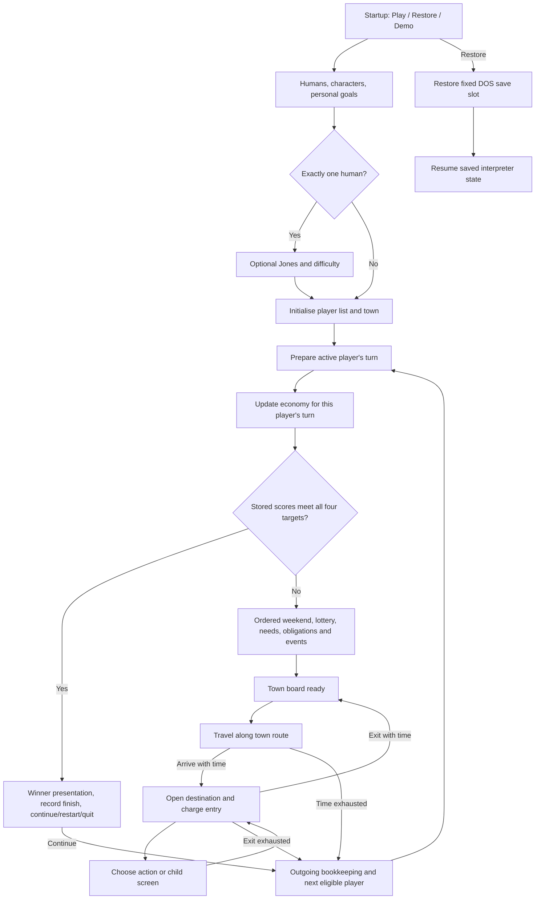

# Original game flow and rule contract

Consolidated 2026-10-16 for the 2.0 planning reference. Edition: website DOS **1.000.060**. This is an analytical model of the original game, not application implementation or approval of redesigned mechanics. **BYTECODE** covers the linked selected package traces; **DOS-STATIC** identifies selected native interpreter paths; conditional reference-engine findings retain their assumptions. **SCRIPT** still covers explicitly unverified paths in earlier domain notes; **OBSERVED** applies only to the recorded runtime sessions.

Read this first for the lifecycle, then follow the domain references for exact tables, arithmetic, callbacks and evidence boundaries. The [readiness record](../planning/rules-readiness.md) separates established behaviour from remaining research and owner decisions.

## Whole-game journey

The diagram combines the normal setup/turn paths; it is not a complete decoder state graph. Restore resumes interpreter state rather than necessarily entering a fresh town turn. Demo is a separate computer-controlled setup route. Cancellation, restart and quit may leave the journey at several points. [Setup baseline](setup-multiplayer.md), [actual setup/location dispatch](../rules-audit/bytecode-flow-and-persistence.md), [turn trace](../rules-audit/bytecode-weekly-opponent.md).

## Round, turn, travel, visit and action

| Unit | Original meaning | State that crosses its boundary |
| --- | --- | --- |
| Game | Participant list, individual targets, placements and shared town/economy | Saves and finishes concern the whole game |
| Round/week | One rotation across eligible participants, accounting for removal | Fourth-week obligations use the shared week number |
| Player turn | A player's nominal 60-unit allowance, preceded by ordered preparation | Per-turn shopping assortment, work/food flags, rejection memory and equipment credits |
| Travel | Moving through the 170-point town route | Residual clock ticks carry between journeys and through explicit actions |
| Location visit | Destination script initialization, priced/action list and eventual return | Every destination entry costs2; some child controls have their own visit-local flags |
| Action attempt | One button/keyboard selection and its checks, effects and feedback | Failure may still spend time or consume randomness; costs are not universally charged only on success |

The economy updates for **each player's turn**, not merely once for the round. Some economic consequences affect other unfinished players. The week increments when the selected participant is the first eligible entry, with removal suppression; an unconditional array-index wrap is insufficient. [Weekly trace](../rules-audit/bytecode-weekly-opponent.md#week-b01-rotation-round-count-and-the-pre-turn-entry).

## The screen structure

The town board remains the spatial hub: thirteen destinations around a route, visible cash/clock/week and participant indicators. Selecting a destination travels there, then opens its dialog over the town. The original is built around compact lists, clerks, short responses and return paths.

| Screen family | Normal contents and return |
| --- | --- |
| Setup | Startup, human count, character selection, one player's goals at a time, optional Jones difficulty/read-only goals |
| Destination | Background, clerk where applicable, context-sensitive actions, prices/items, Exit; Work only for the current employer |
| Child screen | Employer job list, broker, newspaper, pawn selector or diploma; returns to its parent location |
| Progress | Goals overview/detail for participants; current-player Statistics is a separate inventory/status display |
| Interrupting feedback | Confirmation, refusal, success, start-turn notice, event or animation; acknowledge/cue before continuing the suspended flow |
| Finish | Placement celebration followed by Continue/Restart/Quit as appropriate |
| System controls | Save, restore, restart, quit, delete current player and presentation options |

Use the [town and screen layout](town-and-screen-layout.md), [thirteen-destination action inventory](locations-and-actions.md), [component reconstruction studies](screen-reconstruction.md) and [progress/finish baseline](progression-and-finish.md) for layout details. Reconstructed images are partial composites, not full captured screens. Exact typography, modal focus and animation timing remain presentation research.

## Normal turn preparation, in order

1. Outgoing player loses3 dependability; career and protection/debt flags are updated. A just-finished player has a separate rotation path that bypasses normal outgoing penalties.
2. Select the next eligible participant; reset spent hours and movement residue, then immediately run one no-argument clock call (ordinarily leaving residue1); advance the week when applicable.
3. Update the economy for that participant.
4. Apply the eligible ownership happiness increment, then check all four **stored** goal scores. If complete, run the winner sequence and repeat the gate before stamping completion/retiring the player.
5. Otherwise reset turn flags, calculate equipment study credits and assets, run the weekend, then lottery.
6. Process computer ownership income, relaxation decay, apartment theft, food/spoilage/hunger/doctor, consumable decay, rent, clothing, loan warnings, repairs, economic news, cross-player crash consequences and emergency support.
7. Restore board readiness. Notices/child scripts can suspend this sequence; acknowledge them before resuming at the appropriate stage.

Week1 skips much of steps6, **after** economy, goal checks and the initial lottery path. It does not skip all preparation. See the [state-by-state trace and ranges](../rules-audit/bytecode-weekly-opponent.md#week-b04-pre-turn-state-sequence-and-interruption-contract). Selected food/illness and event predicates now have a [direct package trace](../rules-audit/bytecode-needs-events.md); other probabilities and item effects retain the evidence tier of their domain records.

## The ordinary action loops

| Loop | Entry, prerequisites and result | Detailed original rules |
| --- | --- | --- |
| Earn and progress | Agency → employer list → job/raise attempt; then travel to employer → Work. Hiring depends on qualifications, experience, history and opening roll; clothes gate Work. A shift raises experience/dependability within occupation/education limits and pays8×wage for6 nominal time. | [EMP-001–007](../rules-audit/employment.md), [37 jobs](content-progression.md#employment-what-the-lists-actually-offer) |
| Study toward better jobs | University → buy enrollment permission → choose eligible course → repeated lessons → diploma → newly eligible courses/jobs. More paid permissions allow more active courses. Completion adds happiness and work-development credits. | [EDU-001–005](../rules-audit/education.md), [11-course prerequisite graph](content-progression.md#education-the-two-original-starting-branches) |
| Eat and recover | Buy grocery weeks/fast food; inventory and storage affect next preparation. Resident can relax at home. Hunger/illness may consume time before control returns. | [NEED-001–004 / HOME-004](../rules-audit/food-and-housing.md) |
| Maintain housing | Rent office opens services by period/retained flag; explicitly pay, request extension, move or clear arrears. Stored rent contract and outgoing bookkeeping matter; unpaid rent can be garnished from work. | [HOME-001–005](../rules-audit/food-and-housing.md) |
| Buy and use goods | Shops/discount assortment → shared cash transaction → grouped inventory → item-specific effect/feedback. Recurring ownership effects differ from purchase bonuses; repairs/theft/pawn use item attributes. | [GOODS-001–006](../rules-audit/goods-and-finance.md), [confirmed refrigerator ordering](../rules-audit/bytecode-purchase-findings.md) |
| Bank and invest | Transfer cash/savings, apply for loan, repay, or open broker to trade. Bank savings are not automatically spendable carried cash. Prices and contracts use different update paths. | [FIN-001–005](../rules-audit/goods-and-finance.md), [actual loan branches](../rules-audit/bytecode-finance-findings.md) |
| Experience events | Weekends, tickets, lottery, street events, joke products, crashes and recovery follow specific ordering/eligibility. There is no universal event applied after every action. | [EVENT-001–008](../rules-audit/random-events.md), [economy](../rules-audit/economy.md) |

## Time, failure and confirmation contract

All thirteen destination entries charge2 time. Travel has its own residual-clock mechanism. The [conditional reference-engine timing trace](../rules-audit/travel-timing.md) derives route hours from distance, speed and initial residue, with arrival excluded from clock calls; original DOS Animate order remains unverified. Work and lessons cost6; applications/raises4; loans2. Do not infer that every button has a cost, every refusal is free, or every timed action requires its whole nominal cost to remain.

With one hour left, a normal work shift prorates pay, a lesson still awards one increment, and an application still resolves. At already-spent60, those timed handlers refuse. A permitted free purchase, deposit or enrollment can still finish inside the location before Exit rotates the player. Rent garnishment is a confirmed exception to proportional final-shift pay. [Clock/entry trace](../rules-audit/bytecode-flow-and-persistence.md#flow-003-all-thirteen-destination-entries-cost-two), [action boundaries](../rules-audit/time-and-actions.md).

For each action, preserve the original order of eligibility, random draws, payment/time, mutations, score refresh and notices. Same-job applications still run qualification randomness before the raise branch ignores its combined result. A failed opening can be remembered for the remainder of the turn. These are simulation effects even if the feedback looks like a simple refusal.

Human confirmations and clerk/notice presentation are distinct from the action mutation. Jones's policy chooses plans and the common controller emits normal work/exit events. The [all-destination controller inventory](../rules-audit/bytecode-ai-actions.md) confirms selected ordinary dispatch and confirmation shortcuts; full policy/dynamic-path parity remains unproved. [AI trace and boundaries](../rules-audit/bytecode-weekly-opponent.md#ai-b01-policy-location-controller-and-shared-action-are-separate-layers).

## State a faithful model must preserve

These are analytical groups of original state, not an agreed TypeScript schema:

| Group | Required distinctions |
| --- | --- |
| Session | Ordered players, active player, shared week, finish status/week, inactive versus deleted, placement order, pending restart/quit |
| Per-player economy | Carried cash versus savings, loan principal/schedule/late counts, rent contract versus arrears/extensions, investments versus durable goods value |
| Career | Employer, occupation, wage/base wage, experience, dependability, declared minimum, growth ceiling, education credits, clothes and rejection memory |
| Education | Paid enrollment count, per-course quantity, completed qualifications, equipment-credit snapshot and stored education goal score |
| Inventory | Indexed quantities, protection/discount/repair attributes, paid price, per-turn assortment and consumable duration |
| Progress | Four independent targets/scores, refresh timing, capped overview percentage versus finish gate |
| Flow | Board motion and residual clock, active location/child screen, pending action/notice continuation, ready flags and controller plan |
| Randomness | Rule draws, failed-attempt draws and presentation draws; source/version/state needed for reproducible interpretation |

Do not merge net worth into Wealth progress or treat every score as immediately fresh. The actual cash helper computes Wealth from cached liquid assets; the panel separately refreshes assets; goal gates read stored scores. [The full bounded score inventory](../rules-audit/score-refresh.md) traces ordinary action orders and bank mutations after asset refresh; this is not a universal one-action lag.

The [finance lifecycle trace](../rules-audit/finance-lifecycle.md) establishes that pawn aging includes the transaction's end turn, and loan lateness checks payment in the due week even with prepaid schedule credit. Preserve the separate flags and ordered mutations.

The [native economy frame trace](../rules-audit/economy-frame-semantics.md) establishes the main omitted argument as the preceding initialization target draw. The [original DOS random generator](../rules-audit/dos-randomness.md) and scaling are identified statically; exact random frequencies, complete call order and saved state remain separate. Neither a zero parent default nor a uniform modern RNG is an established original rule.

The original writes fixed DOS slot1 with a version argument, while the browser's persistence remains unverified. A future versioned local save should capture the new simulation/continuation contract; adopting it does not require reproducing DOS serialization. [Persistence boundary](../rules-audit/bytecode-flow-and-persistence.md#save-001-fixed-slot-kernel-boundary).

## Build-planning boundary

The normal game journey, screen families and core employment/study/turn contracts are now explicit enough to review as a connected specification. Remaining uncertainties are listed in [rules readiness](../planning/rules-readiness.md); they must remain visible when choosing compatibility and implementation scope. No application work, revised content, fixed bugs or altered victory timing is approved by this reference alone.
