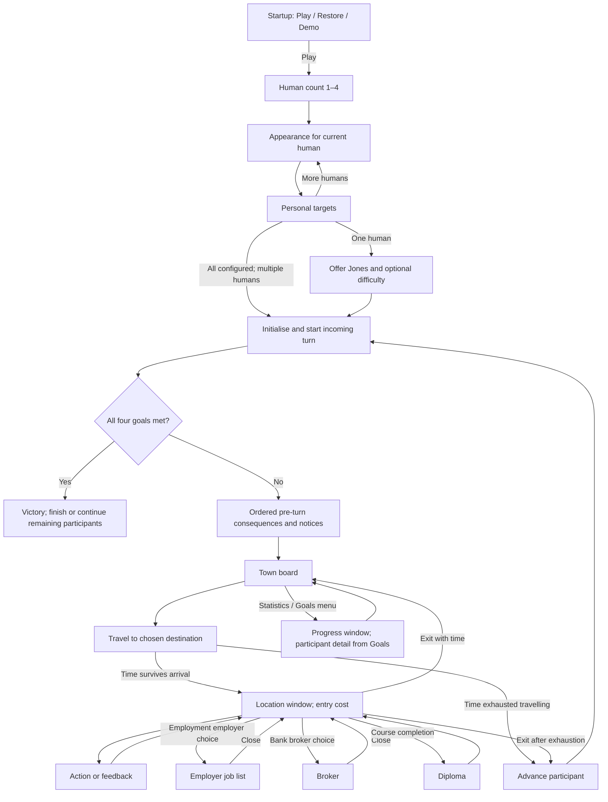

# Original screen reconstruction and interaction flow

Research: 2026-10-15, website package DOS 1.000.060. This is a visual research pass before adaptation design. **DECODED** component pixels come from the checksum-locked package; **SCRIPT** placement and transitions come from the separately published decompilation at `870a8015b689474484bf3d8b41416956d4315432`. That source has not been independently matched to the package bytecode. No study is an OBSERVED runtime screenshot. The subsequent [runtime observation log](../rules-audit/runtime-observations.md) supplies separate actual captures; it does not retroactively turn composites into screenshots.

The local gallery now contains **18 partial analytical composites**, a town-background study and a victory component sheet. It makes the central-window composition inspectable while keeping generated original artwork out of Git. [Recipes](../../artifacts/original-game/screen-study-recipes.json) contain only resource IDs, coordinates, state assumptions, source links and analytical notes. Each layer links to its source instance. [Exporter](../../tools/research/reconstruct_screen_studies.py) creates PNGs, numbered bounds, a linked HTML gallery and a manifest of input/output hashes.

## Rebuild and inspect

First [decode the original assets](../discovery/rebuild-original-assets.md). With the same Python/Pillow environment, run from the repository root:

```sh
work/asset-venv/bin/python tools/research/reconstruct_screen_studies.py
```

Open `work/original-screen-studies/index.html`. Optional `--assets PATH` selects an existing decoded catalogue; `--output work/another-study-directory` changes the ignored output location. The source archive hash must match the recipes. No downloaded scripts are required to render the committed recipes. Their revision, source links and input hashes are retained for review.

Images preserve the 320 × 200 logical canvas with square pixels. The decoded town picture supplies the surrounding frame; common dialogs are composed at `(69,44)` with extent `184 × 119`. A grey fill is an explicitly artificial placeholder where the runtime window surface is missing. Numbered images show actual placed cel bounds, not inferred click areas. The window-manager port/border adjustments, priority masks, palette flags and display aspect correction are not simulated.

## Screen studies and what they establish

| Study | Reconstructed components / selected state | Dynamic presentation still missing |
| --- | --- | --- |
| Startup | Three illustrated choices | Focus, window treatment and the real board state behind startup |
| Human count | Four numbered choices | Heading and focus |
| Appearance | Four bodies, player-number artwork and selection buttons | Dimming previously chosen bodies and later-player state |
| Personal goals | Goal frame, setup title, four stars at 50, help/proceed | Goal Points text, participant markers and current-progress detail mode |
| Challenge Jones | Offer background with Yes/No | Question text and focus |
| Jones difficulty | Same background with three difficulty buttons | Changed prompt and Jones's subsequently assigned goals |
| Socket City | Branded frame, one clerk frame, Exit and conditional Work | Item/price rows, time-clock, greeting, purchase animation and cash |
| Bank | Branded frame, one clerk frame, Exit and conditional Work | Amount selectors, loan/payment/broker text, balances and time-clock |
| Employment agency | Agency background, clerk and Exit | Employer text list and selection highlights |
| Monolith job list | Employer-list background and Exit at agency origin | Heading, four wage/job rows, qualification highlighting and result |
| Hi-Tech U | Background, clerk, two-book stack, initial two course labels, Enroll/Exit | Fee, session counter, focus, optional Work and diploma transition |
| Low-cost home | Resident background and initial chair/saying/stool, Relax/Exit | Alternate nonresident background and relaxation feedback |
| Security home | Resident background with illustrative TV/books/VCR, Relax/Exit | Other ownership combinations, nonresident art and stereo uncertainty |
| Statistics | Statistics background and Done | Current-player scrolling list and scrollbar |
| Who's Winning | Four-participant frame and player selectors | Actual participant count, percentages and progress fills |
| Newspaper | Background, one paper frame and Done | Headline/body, unfold animation and originating event |
| Diploma | Background, one diploma frame and Done | Qualification/player text and animation |
| Broker | Investment symbols with Buy/Sell/Exit | Prices, holdings, selected mode and amount/transaction feedback |
| Town background | Decoded picture 11 | Menu, cash, clock/week, marble, player markers and doors |
| Victory components | Decoded view 609 contact sheet | Actor/baseline composition, winner body/clothes, timing and confetti |

These are representative screen families. They are not a complete reconstruction of every shop, event, menu, restore dialog or every state within a screen. Several list-heavy screens are deliberately shells; blank areas do not establish an empty original screen.

## Flow and ownership of the central area

The original uses the town as the frame for a succession of focused windows. A normal destination's Exit closes that visit; a nested job list returns to its parent agency and the broker returns to the bank. Notices, diplomas and clerk feedback interrupt the current flow; they are not additional town destinations. The [location catalogue](locations-and-actions.md) describes each service and its conditions.



This is the normal route, not an exhaustive state machine. Restore resumes saved state; Demo has its own controller; finish/deletion skips participants; fourth-week and first-week branches remain in the [weekly audit](../rules-audit/weekly-processing.md). A specific purchase/work/study action may resolve feedback or time while its dialog is still open. Do not turn the diagram into an invented rule that every action immediately closes the location when time reaches zero.

## Actions, feedback and turn handover

| Trigger | Original presentation / return path | Source and validation scope |
| --- | --- | --- |
| Select a town destination | Marble movement, arrival, then central visit if time permits | [Town/path](town-and-screen-layout.md); runtime path pacing pending |
| Select an ordinary purchase | Availability/affordability check, state update and clerk success/refusal feedback in the visit | [Purchases and finance audit](../rules-audit/goods-and-finance.md); exact feedback timing pending |
| Select Work | Work interaction, wages/time display; button exists only at current employer | [Time/actions](../rules-audit/time-and-actions.md); partial-shift boundary retained |
| Select a university course | Prerequisite-filtered book label; enrolment/session handling; diploma interruption at completion | [Course graph](content-progression.md), university recipe sources |
| Select employer at ACNE | Employer-specific job list replaces central content; return restores agency | [Employment flow](locations-and-actions.md#subscreens-and-returns); direct sources are `employment` and `fastFoodJobs` in recipes |
| Select See Broker at bank | Nested investment controls, then return to bank | Broker recipe and [finance audit](../rules-audit/goods-and-finance.md) |
| Open Statistics | Current-player list; Done dismisses it | [Progress views](progression-and-finish.md) |
| Open Who's Winning | All participating players' progress; participant selector opens four-goal detail | [Progress views](progression-and-finish.md) |
| End a turn | Advance participant, update identity/clothes/cash/time, incoming player starts at housing; week advances on wrap | [Setup/handover](setup-multiplayer.md#shared-device-turn-handover) and [weekly audit](../rules-audit/weekly-processing.md) |
| Meet targets | Start-turn victory check, podium/animation and finish/continue handling | [Finish](progression-and-finish.md); no screenshot reconstruction asserted |

No extra ready/privacy screen was found in the inspected handover path. There is therefore no separate handover composite in this pass. Menus, confirmation dialogs, greetings and amount selectors need runtime captures before precise visual treatment is considered established.

## State-dependent details and unresolved correspondence

- University initially offers Trade School and Junior College. `localproc_3` adds eligible courses in reverse progression order. `addCourse` places label x at book x+5 and y at `108−14×eligibleIndex`; two courses choose stack cel 1 at y70. The study applies these formulas rather than drawing all eleven options together. [University source](https://github.com/sluicebox/sci-scripts/blob/870a8015b689474484bf3d8b41416956d4315432/jones-dos-1.000.060/src/university.sc#L117).
- Goal stars use cel `(target−1)/10`; target50 therefore uses cel4. Setup changes its title to view506; current-goal detail uses view501 and adds state-dependent markers. A static setup study must not be treated as the detail view. [Goal source](https://github.com/sluicebox/sci-scripts/blob/870a8015b689474484bf3d8b41416956d4315432/jones-dos-1.000.060/src/select3.sc#L73).
- Low-cost and security interiors change backgrounds for nonresidents. Security possessions are conditional. The published stereo instance specifies view702, loop1, cel4, while the decoded package's view702 has one loop. The stereo is omitted pending interpreter fallback/bytecode/runtime investigation; no silent substitution to loop0 is made. [Security instance](https://github.com/sluicebox/sci-scripts/blob/870a8015b689474484bf3d8b41416956d4315432/jones-dos-1.000.060/src/security.sc#L161).
- Talker frames shown here are illustrative static speech components. Presence in a composite does not establish that the face stays visible through every interaction. The runtime Print/Talker lifecycle and palette changes need comparison.
- Actor x/y positions in the victory script use different geometry from DIcon top-left control coordinates. The exporter composes only DIcon-like layers and supplies the victory sheet separately. [Victory source](https://github.com/sluicebox/sci-scripts/blob/870a8015b689474484bf3d8b41416956d4315432/jones-dos-1.000.060/src/winnerScript.sc#L21).

## Validation and next evidence

All referenced cels must exist or rendering fails. The generated manifest records each used image's hash, the recipe/renderer hashes and every layer's placed bounds. A repeated render matched all 40 generated files byte-for-byte; all 38 PNGs passed file verification, and representative setup, university, shop, apartment and broker images were visually inspected. Browser checks cover gallery navigation and annotated-layer disclosure. These checks verify this research artifact, not visual equivalence to the running game.

The highest-value next captures are the first setup sequence, a shop greeting/purchase, a bank amount/loan, agency → job list → application, two initial university courses and graduation, both resident/nonresident homes, statistics, two-human handover and victory. Record native geometry, selected state, input sequence, edition and capture provenance. Add animation/audio timing separately. Until then, these studies are sufficient to review composition and flow, but not to approve pixel-perfect reproduction or final adaptation wireframes.
