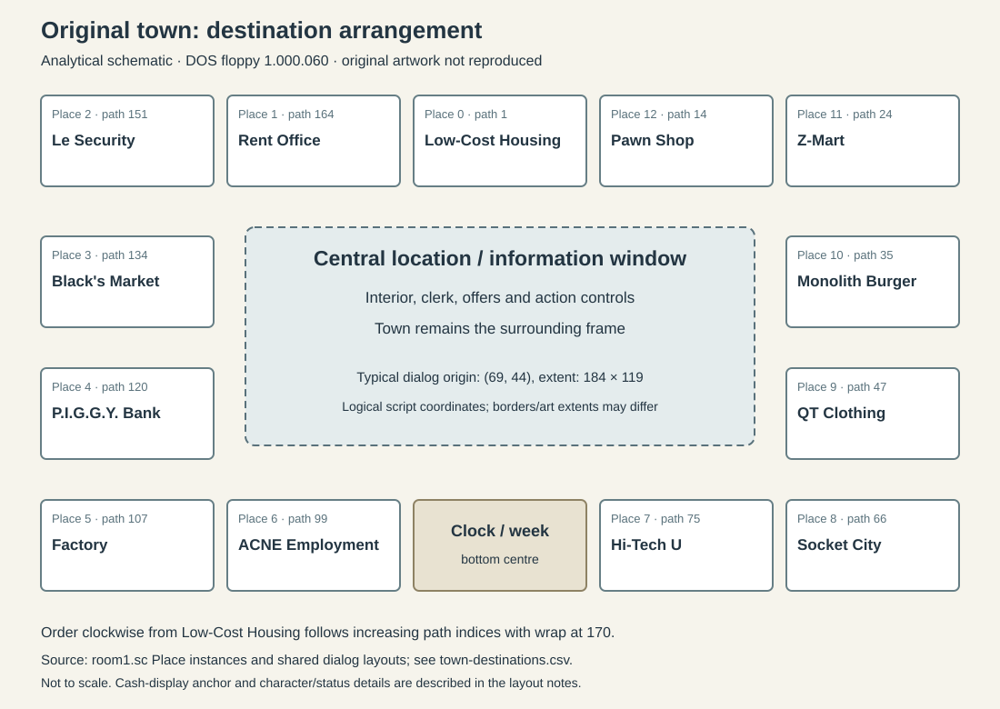
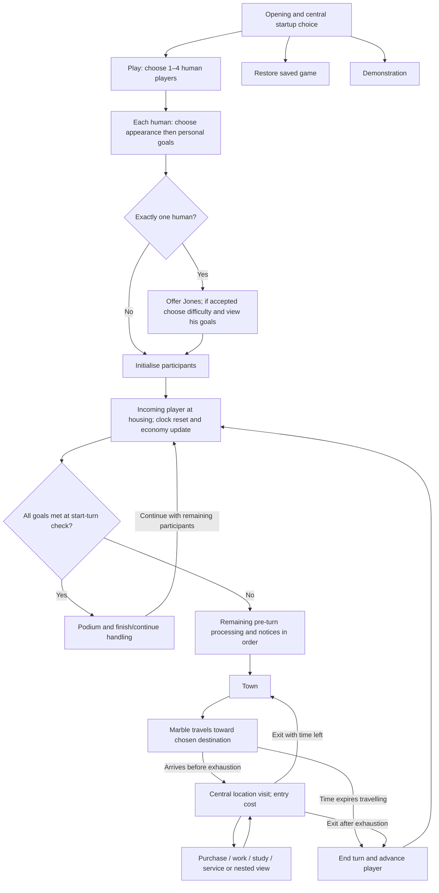

# Original game: town and screen layout

Research date: 2026-10-15. Reference: DOS floppy **1.000.060**. Evidence: **SCRIPT** from the pinned published decompilation, with **DOCUMENTED** visual cross-checks from the original ©1992 reference card. This describes the original; it is not a new interface proposal. Exact artwork, animation timing, and every graphical label have not been captured from the reference runtime.

## One town as the persistent frame

Thirteen selectable destinations sit around a compact town route. The travelling player is a marble, with a character/walker and player-number markers providing identity. The [first runtime session](../rules-audit/runtime-observations.md) confirms that the ordinary board shows the current player’s full body in the central area, with four numbered corner markers, between visits. Visiting a building opens a central window; it does not take the player into a freely explorable map. The town remains the surrounding frame. The broker, employer job lists, newspaper, and diploma are nested presentations rather than additional buildings.

Source: [room1.sc, Place and destination instances][town]; [marblePath.sc][path]. See the [location catalogue](locations-and-actions.md) for what each visit contains.

The figure is our analytical schematic, not extracted artwork or a pixel-perfect tracing. Names and arrangement derive from the destination definitions. [Machine-readable destination inventory](../../artifacts/original-game/town-destinations.csv) records IDs, path indices, click rectangles, and location script numbers.

## Original spatial order

| Region | Destinations in screen order |
| --- | --- |
| Top, left to right | Security Apartments → Rent Office → Low-Cost Apartments → Pawn Shop → Z-Mart |
| Right, downward | Monolith Burgers → QT Clothing → Socket City at the lower-right corner |
| Bottom, left to right | Factory → ACNE Employment → clock/week area → Hi-Tech U → Socket City |
| Left, downward | Black's Market → Bank → Factory at the lower-left corner |

Corner locations appear twice in this regional explanation; there are **13 unique destinations**, not 15. From Low-Cost Housing, the clockwise route is Pawn → Z-Mart → Monolith → QT → Socket City → University → Employment → Factory → Bank → Market → Security → Rent Office → home. The travel path selects the shorter direction; the inventory's route indices are not equal-distance spaces or time costs. [Sources][town], [path].

## Layout anchors from scripts

| Element | Original implementation detail | What it establishes |
| --- | --- | --- |
| Typical location/setup window | Logical extent 184 × 119, moved to `(69, 44)` | A common central viewing area across many screens |
| Clock | Anchor `(159, 180)` | Time display at bottom centre |
| Week label | Drawn near `(140, 184)` | Week is associated with the clock area |
| Cash calculator | Anchor `(252, 160)`; digits drawn relative to it | A separate lower-right cash display, not a full-width modern status bar |
| Shop clerk base class | Default local x-position 115; individual screens vary y/art | Character-led menus with screen-specific compositions |
| Typical Exit | Local position `(143, 108)` | Common lower-right exit control within a visit |
| Typical workplace Work | Local position `(75, 108)` | Work alongside the visit controls when eligible |

These are logical script coordinates/anchors. Picture and sprite extents, borders, screen ports, and VGA aspect correction must be inspected before treating them as final rendered rectangles. The CSV contains click regions, which need not match the visible edge of a sign or building.

Sources: [room1.sc, calc/timeKeep/week label][town]; [appliance.sc, dialog/Work/Exit][appliance]; [WButton.sc, Talker][buttons]. The original [reference card][card] independently illustrates the clock/week and cash-calculator motifs.

## Screen families rather than a generic dashboard

| Original screen family | Composition and navigation | Evidence |
| --- | --- | --- |
| Startup / participant selection | Central illustrated choices; player-count buttons; four character choices | `select1`, `select1b`, `select2`; [setup](setup-multiplayer.md) |
| Goal selection / detail | Four vertical star sliders; total goal points; help and proceed/exit controls; detail view locks targets and adds current markers | `select3`, `goalsDefine`; [progress](progression-and-finish.md) |
| Ordinary shop / service | Location art, clerk, short priced list, item art or special feedback, Exit; conditional Work and time-clock | `appliance`, `market`, `bank`, `clothing`, `fastFood` |
| Employment | Employer selector, then a distinct job list for that employer; application feedback returns to the agency flow | `employment`, employer job scripts |
| University | Book-like course presentation, sessions remaining, enrollment, changing prerequisite-filtered selection; diploma interruption on completion | `university`, `diploma` |
| Homes | Apartment interior, resident-only Relax, fixed decoration or specific owned props | `lowcost`, `security` |
| Statistics | Current-player scrolling text/list panel | `inventories` |
| Who's Winning / Goals | Per-player thermometer/percentage overview; select a participant for four-goal detail | `viewGoals`, `select3` |
| Events and celebration | Newspaper, notice art, weekend vignette, diploma, or podium with animated stars and confetti | `newspaper`, `noticeRoom`, `weekend`, `diploma`, `winnerScript` |

Source files are linked through the [source inputs](../../artifacts/original-game/2026-10-15-source-inputs.json), [locations](locations-and-actions.md), and [setup/progress](setup-multiplayer.md) references. The original card illustrates goal and statistics panels; it does not supply every location screen or exact floppy appearance.

The original uses small, context-specific interactions rather than persistent panels for every system. Normal purchases immediately resolve an affordability check and feedback; some high-impact transactions, such as borrowing or moving, use confirmation paths. There is no evidence in these paths for a shopping basket, a permanent job dashboard, or free-placement furniture editing.

## Original flow between screens

[View rendered diagram (PNG)](../../artifacts/diagrams/original-game--town-and-screen-layout.png) · [Zoomable SVG](../../artifacts/diagrams/original-game--town-and-screen-layout.svg) · [All diagrams](../diagrams/README.md)

This is an analytical normal-path diagram. Restore resumes stored state, not necessarily a fresh turn; demo uses its own control path. First-week skips, retirement/removal, notices, and full save semantics are described in the linked audit rather than flattened into every diagram branch. No separate privacy/ready handover screen was found in the inspected original path.

## Reconstruction studies

The [screen reconstruction](screen-reconstruction.md) now provides state-qualified local composites and annotated layer bounds for setup, shops, homes, university, progress and interruptions. It also records nested returns and deliberately unrendered dynamic content. Use it alongside this structural baseline.

## Evidence still needed for visual fidelity

- A [local asset catalogue](asset-catalogue-notes.md) and [18 analytical screen composites](screen-reconstruction.md) now establish decoded components and script placement. Complete text/animation/state transcription and runtime comparison remain open; partial composites are not screenshots.
- Capture representative original screens at their native geometry, including both homes, a shop, employment, university, statistics, goals, a handover, and finish. Browser inspection during this pass reached the opening notice but then produced a blank game display; it did not establish gameplay observations.
- Distinguish floppy and CD presentations. The ©1992 reference card is useful original material, but not proof that every image or rule matches the website's floppy build.
- Check pacing and sound in play. Bed-music calls and animated Talker classes establish that presentation is part of the design; they do not establish that timing or audio was heard in this pass.

[town]: https://github.com/sluicebox/sci-scripts/blob/870a8015b689474484bf3d8b41416956d4315432/jones-dos-1.000.060/src/room1.sc
[path]: https://github.com/sluicebox/sci-scripts/blob/870a8015b689474484bf3d8b41416956d4315432/jones-dos-1.000.060/src/marblePath.sc
[buttons]: https://github.com/sluicebox/sci-scripts/blob/870a8015b689474484bf3d8b41416956d4315432/jones-dos-1.000.060/src/WButton.sc
[appliance]: https://github.com/sluicebox/sci-scripts/blob/870a8015b689474484bf3d8b41416956d4315432/jones-dos-1.000.060/src/appliance.sc
[card]: https://www.sierragamers.com/wp-content/uploads/2019/12/Jones_In_The_Fast_Lane_Reference_Card.pdf
