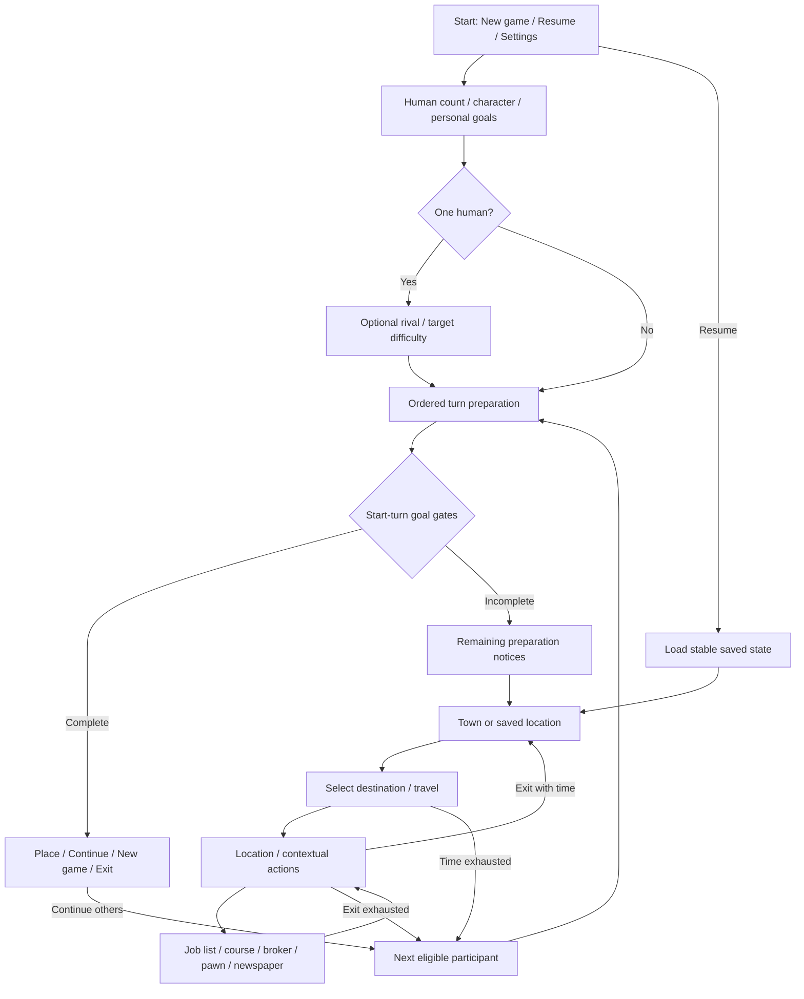

# 2.0 draft: preserve the game, renew the town

**Revision notice2026-10-17:** the owner's subsequent transport/new-location/job-board/device pointers are developed in the [modern-direction review](modern-direction-review.md). Use its amendments and the current [first playable scope](first-playable-scope.md) for travel, Learning, town/content and prototype modes; this earlier draft and its diagram retain the original-first starting point. Neither version is an approved build specification.

2026-10-17. **PROPOSAL — for review, not an approved build specification.** The confirmed direction remains the [brief](project-brief.md) and D001–D010 in [decisions](decisions.md). Original facts belong to the [research handoff](original-research-handoff.md); this document recommends how to use them.

## Recommended starting point

Make the same compact race through working life: choose personal targets, travel around a small town, work, study, shop, maintain a home and weather economic swings. Keep the strategic awkwardness of spending scarce time and money. Renew names, characters, writing and illustrations before expanding the systems.

Use the inspected website DOS **1.000.060 floppy** as the single mechanical reference. Do not combine its prices and event ordering with CD recovery rules. A successor rules version should identify every adopted departure in the [compatibility proposals](compatibility-proposals.md); no selectable historical-emulation mode is proposed for the first release.

Recommend desktop and landscape tablet first, with mouse, touch and keyboard. Phone layout needs its own review before claiming equal support. There is no agreed session duration: retain configurable goals and measure actual family sessions before promising a short-game preset.

## Keep, reskin, change

| Area | Proposed treatment | Boundary and original reference |
| --- | --- | --- |
| Four goals | KEEP Wealth, Happiness, Education and Career, personal targets 10–100 in tens, first default 50 each, later editable inheritance | Keep the distinct scoring meanings; Career is not salary and possessions are not automatically liquid Wealth. [Setup](../original-game/setup-multiplayer.md), [scoring](../original-game/progression-and-finish.md) |
| Modes | KEEP solo, one human plus optional computer rival, or 2–4 humans | No mixed multi-human/AI setup in the initial scope. Broader combinations remain possible later. [Original combinations](../original-game/setup-multiplayer.md#original-supported-combinations) |
| Starting position | KEEP cash 200, low-cost housing, prepaid rent 3, casual clothing 6, no food/job/degrees/durables | Use the full allocation and first-turn exceptions, not merely the visible cash. C04 proposes keeping zero allocation scores but recalculating Wealth after the first relevant mutation, including incoming economy revaluation; that first-turn score effect is a departure. [Fresh state](../rules-audit/initial-player-state.md) |
| Town | KEEP 13 roles, ring topology and nested services | Broker, newspaper and job lists stay inside their parent destinations. [Layout](../original-game/town-and-screen-layout.md) |
| Time and turns | KEEP 60 nominal units, entry 2, shifts/lessons 6, ordinary partial actions and location-exit boundary | Travel calculation is a specific compatibility choice; animation duration must not accidentally decide it. [Action contract](../original-game/game-flow-and-rule-contract.md#time-failure-and-confirmation-contract) |
| Jobs and courses | RESKIN labels while retaining 37 job records, 11 courses, eligibility graph and initial balance tables | Not every real modern occupation fits the existing graph. Use fictional roles; reject a label if it misrepresents its prerequisite. [Progression](../original-game/content-progression.md), [sample](content-iteration-sample.md) |
| Goods | RESKIN selected objects in their existing functional slots | A connected speaker replacing a stereo does not introduce subscriptions or a new income stream. Storage, equipment and clothing grades keep their roles. [Goods](../rules-audit/goods-and-finance.md) |
| Economy | KEEP layered indices, contract-versus-quote differences, incoming-player update and setbacks | No universal once-per-week price update, inflation simulator or automatic wage matching. Edition/bug choices remain explicit. [Economy](../rules-audit/economy.md) |
| Humour and art | RESKIN with original illustrated retro characters, storefronts, props and short fresh jokes | Preserve visual warmth and clerk-led feedback. No original art, dialogue or code ships with the successor. Exact style needs an art sample. [Screen studies](../original-game/screen-reconstruction.md) |
| Usability | CHANGE text size, touch targets, keyboard focus, cost labels and explanations | These should expose the same decisions. Extra information that reveals hidden odds or opponent knowledge requires a rules decision. |
| Persistence and simulation | CHANGE to an explicit modern rules/save contract | Reproducible randomness and read-only UI inspection differ from original native/cache behaviour. See [architecture proposal](architecture-and-validation-proposal.md). |
| New systems | DEFER leaderboard, online play, social feeds, crafting, extra meters and daily tasks | They are not required to deliver the requested game. A leaderboard is a later service decision. |

“KEEP” here recommends carrying a feature forward; it does not certify complete native equivalence. “RESKIN” changes presentation/content only if all functional relationships remain unchanged. “CHANGE” requires a recorded rule or interaction decision.

## Screen flow

The proposed screen families follow the [original connected journey](../original-game/game-flow-and-rule-contract.md). New controls below are explicitly proposals.

[View rendered diagram (PNG)](../../artifacts/diagrams/planning--2.0-draft-specification.png) · [Zoomable SVG](../../artifacts/diagrams/planning--2.0-draft-specification.svg) · [All diagrams](../diagrams/README.md)



This is a navigation summary, not the preparation algorithm: ownership effects, the second finish gate, week1 skips and interrupted notices retain the precise [ordered contract](../original-game/game-flow-and-rule-contract.md#normal-turn-preparation-in-order). Resume returns to a supported saved boundary, not a fresh turn. Settings, Goals and Statistics return to their caller.

| Screen | Proposed contents and behaviour | Review question |
| --- | --- | --- |
| Start | New game, Resume when valid, Settings; explain that progress is saved on this browser | Is the difference between Resume and New game clear? Original demo can wait until the rival is complete. |
| Setup | Human count, distinctive character choices, each participant's four targets, brief explanations; optional rival only after single-human setup | Can each child explain that targets are a finish line, not starting resources? Appearance gives no abilities. |
| Town |13 destinations, participant marker, week, remaining time, cash; Goals, Statistics and menu | Can a player find their workplace, university, food and home without a tutorial overlay? |
| Location | Clerk/scene, concise action list, prices and stated time costs, contextual Work, Exit; item art beside selection | Can a player distinguish getting hired at the agency from working at the employer? Show expected partial-shift pay only after its rule is agreed. |
| Nested view | Employer jobs, broker holdings, course book, pawn selection, newspaper or diploma | Back returns to the parent; it never implies free travel or extra buildings. |
| Feedback | Plain outcome first, then one short character line; acknowledgement resumes the pending flow exactly once | Can a child distinguish missing qualification, experience, clothes, cash, time and a closed vacancy? Do not promise an opening merely because requirements are met. |
| Goals | All participants' overview, select one for four scores/targets and explanations | Keep public goal information. Do not add secret-player screens by default. |
| Statistics | Current player's employment, cash/savings/debts, holdings, food/clothes and qualifications | Keep it distinct from Goals; opening a panel should have no new simulation effect under the proposed read-only UI contract. |
| Handover | Brief “Player 2 — your turn” cue after outgoing exit, followed by ordered incoming notices | Proposed pacing aid, no privacy screen and no new week/timer cost. An acknowledgement must not rerun preparation. |
| Save/resume | Automatic stable checkpoint, manual save/export/import in menu; readable failure/recovery feedback | Does reloading preserve the active participant, location, remaining time and next random outcome? Detailed policy is in the architecture proposal. |
| Finish | Place, four attained targets, finish week; Continue when others remain, New game and Exit | Keep start-turn completion timing. Do not announce a win as soon as an action fills a meter. |

## Layout sketches

**Proposed low-detail composition, not approved art or final dimensions.** Preserve the original destination order. Responsive sizing must not alter simulation route lengths.

```text
┌──────────────────────────────────────────────────────────────────┐
│ Player 1     Week 3     Time left: 42     Cash: $…     Menu        │
│ Security home → Rent office → Low-cost home → Pawn → Discount shop│
│ ↑                                                       ↓        │
│ Market       ┌───────────────────────────────┐      Fast food      │
│ ↑            │        TOWN / VISIT           │           ↓        │
│ Bank         │    clerk + selected item      │      Clothing       │
│ ↑            │   action / price / time       │           ↓        │
│ Factory ← Employment ← University ←─────────── Appliance shop      │
│              └───────────────────────────────┘                    │
│ Goals     Statistics                  active player / route      │
└──────────────────────────────────────────────────────────────────┘
```

The placement sketch uses semantic arrows around the ring, not an authoritative directional travel algorithm; the native route/clock rules are separate. The university remains left of Socket City and right of Employment; all 13 destinations remain. See the [original town schematic](../../artifacts/original-game/town-arrangement.svg) for source geometry and the week/clock area omitted from this simplified ring.

```text
┌─ LOCATION: employment agency ──────────────────────────┐
│ Clerk portrait     Choose an employer                  │
│                                                       │
│ Employer list → Jobs: title / offered hourly wage      │
│ Selected job: required course, experience, work history│
│                                                       │
│ Apply — 4 time     Back to employers     Exit agency   │
│ Feedback: outcome, then one brief joke                 │
└───────────────────────────────────────────────────────┘
```

The explanatory requirement line is a proposed disclosure of deterministic conditions, not live vacancy odds or a promise of success. It must reflect the actual evaluated rule. Other visits reuse the same composition with their own controls, rather than adding permanent work/study/shopping dashboards.

## First playable slice after planning approval

Recommend **one human, no rival, original allocation and core data**, with the same engine boundaries intended for later multiplayer. Cover town travel, employment, low-cost home, market, clothing, rent office and university. Other destinations can be visibly marked unavailable in this development slice; this incomplete town is a development limit, not a proposed released game.

Acceptance journey: start → get a suitable job → visit employer and work → buy food → enroll and study toward a better job → handle first recurring upkeep → reach week 4 and pay rent → save/reload without changing outcomes. “Complete a week” alone does not exercise the rent-service period. Use a separate controlled scenario for graduation, partial final actions and finish; no need to grind a whole campaign to validate those boundaries.

Then extend to the full 13 destinations, complete goods/finance/events, shared-device rotation and computer opponent before calling it the full game. Introduce original illustrated art through one representative town/visit/home comparison after the wireframe review. Do not set a public release date or promise balanced session length from this slice.

## Family review script

Run these on the wireframes first, then repeat on the approved slice. These are planned checks, not completed playtests.

1. Ask each child and an adult to find a job and show where to work. Ask what a rejection means and what they would do next.
2. Give a rent-week situation. Ask which money is spendable, where rent is paid and what must wait until next turn.
3. Show a course prerequisite and two possible jobs. Ask them to explain the route to the better job without adult prompting.
4. Show a price change with a stored wage/contract. Ask why the current offer and existing arrangement differ.
5. Show handover, then Goals. Ask whose turn it is, what everyone can see and when the week advances.
6. Show all four goals attained during a visit. Ask when the finish is checked; revise the explanation if they expect an immediate win.
7. Ask which clerk line was funny, unclear or mean. Record comprehension separately from strategic difficulty.

Record observed answers and assistance required; do not treat approval of the look as proof of rule comprehension or balance.

## Decisions this pack makes ready

Recommended review order: **reference edition and compatibility choices → screen flow/devices/modes → content sample → architecture/slice → art sample**. This pack supplies concrete proposals for those reviews. Only owner decisions belong in the confirmed section of the decision register. New systems, scope expansion and application implementation need subsequent direction.
