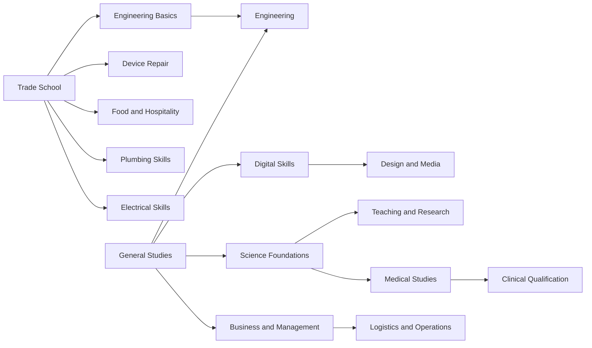

# Career and town graph v2

2026-10-17. **Accepted direction:** preserve a quick trade-school-to-butcher route; include skilled trades such as electrician/plumber and an education-led doctor career; keep practical and professional routes competitive; deliberately redraw the graph instead of pretending the original eleven courses cover everything. The owner accepted the preceding direction with “sounds good.” **Every specific course edge, role, location grouping and balance recommendation below is a PROPOSAL.** No application implementation is approved.

This develops the [modern-direction pack](modern-direction-review.md) and [employer/device options](employers-offers-and-useful-possessions.md). The [37-job mapping](../../artifacts/planning/modern-content-mapping.csv) remains the original-graph naming reference, not this successor graph. Original research is unchanged.

## The three useful routes

| Route | First useful qualification | Example payoff | What keeps it competitive |
| --- | --- | --- | --- |
| Quick practical | Trade School | Butcher, assembly work, entry to specialisations | One completed course opens a worthwhile earning job; later specialisation is optional |
| Skilled trade | Trade School, then Electrical Skills or Plumbing Skills | Qualified electrician/plumber, later contractor role | Two-course route; paid junior work can fund study without becoming a separate apprenticeship simulator |
| Professional | General Studies, then a longer subject branch | Doctor, engineer, advanced creative work | More time/cash investment and higher eventual pay potential; no automatic victory or guaranteed vacancy |

**Butcher benchmark:** a player can choose Trade School as their first course, finish it, and apply for Butcher without General Studies, business education or a second qualification. Experience, work history, suitable clothes and an opening still matter. The goal is a compelling early strategy, not guaranteed immediate hiring. Do not demote the role to a generic food-prep label or make it a compulsory gateway to every better job.

## Proposed course graph

These are simplified fictional game qualifications, not real credentials or licensing advice. All are studied through the existing learn/attend/graduate interaction. There is no separate exam, placement, clinical-practice or apprenticeship minigame. Course names below are new planning identifiers; they do not overwrite original course IDs10–20.

[View rendered diagram (PNG)](../../artifacts/diagrams/planning--career-and-town-graph-v2.png) · [Zoomable SVG](../../artifacts/diagrams/planning--career-and-town-graph-v2.svg) · [All diagrams](../diagrams/README.md)

Sixteen proposed courses, two open starting branches. Arrows are prerequisites; Engineering requires **both** Engineering Basics and General Studies. All other non-root nodes have the single prerequisite shown. This graph is a proposal for the successor, not an extracted original finding. More courses are a content expansion and must earn their place through distinct job uses.

| Proposed qualification | Direct career purpose |
| --- | --- |
| Trade School | Butcher and assembly work; opens four specialisations plus engineering preparation |
| Electrical Skills | Electrician |
| Plumbing Skills | Plumber |
| Food and Hospitality | Chef; ordinary entry-level cook remains accessible without it |
| Device Repair | Device technician |
| Engineering Basics | Machine-shop assistant; prerequisite for Engineering |
| General Studies | Office/admin entry beyond unqualified work; opens business, science and digital branches |
| Business and Management | Selected management and contractor roles, not every supervisory job |
| Science Foundations | Medical and teaching/research branch entry |
| Medical Studies | Prerequisite for Clinical Qualification; no automatic doctor job at this stage |
| Clinical Qualification | Doctor; four-course route including General Studies and Science Foundations |
| Engineering | Engineer; four-course route including both its prerequisite branches |
| Digital Skills | Junior studio role and selected office work |
| Design and Media | Designer; three-course route including General Studies and Digital Skills |
| Logistics and Operations | Advanced dispatch/route planning roles; three-course route including business |
| Teaching and Research | Lecturer/tutor progression in the fictional learning centre |

**Length and scoring are not yet settled.** Start comparisons with the existing six-time lesson action and common course-completion mechanics. Do not invent extra fees or a new meter per profession. Lesson counts, tuition, equipment credits and the Education goal need a joint balance sheet: sixteen available courses change the choices compared with eleven. The original completion-count scoring is a reference, not a silently adopted successor formula. Test whether several cheap completions crowd out worthwhile specialisation before deciding weights or counts.

## Employer ladders and alternative branches

Each row gives candidate roles, not mandatory promotions. A player may apply directly for any role they qualify for. Experience/dependability thresholds, clothing, wages, openings and remote eligibility still need per-job records. A shared title such as Manager does not mean the same job record everywhere.

| Employer or career family | Entry and intermediate work | Qualified / advanced roles | Key qualification choices |
| --- | --- | --- | --- |
| Grocery | Cleaner, checkout assistant | **Butcher**, supervisor, store manager | Butcher: Trade School only; higher management can use Business |
| Café / restaurant | Kitchen hand, counter assistant, cook | Chef, venue manager | Chef: Food and Hospitality; manager is a separate business/history path, not automatically the next chef rank |
| Electrical contractor | Trade assistant / junior electrical role | Electrician, contractor manager | Electrician: Trade School + Electrical Skills; manager additionally Business |
| Plumbing contractor | Trade assistant / junior plumbing role | Plumber, contractor manager | Plumber: Trade School + Plumbing Skills; manager additionally Business |
| Manufacturing works | Cleaner, assembly worker, machine-shop assistant | Machinist, engineer, production manager | Trade School and Engineering Basics support practical work; Engineering for engineer; management requirements specified separately |
| Clinic | Receptionist, medical administrator | **Doctor**, practice manager | Doctor: four-course medical route; administrator/manager use general/business route. Practice manager does not require first being a doctor |
| Parcel depot | Sorter, dispatch assistant | Dispatcher, route planner, depot manager | Qualifications for advanced work use Logistics/Business; no automatic driving minigame or vehicle gate |
| Digital studio | Studio assistant, junior digital worker | Designer, producer, studio manager | Digital Skills and Design and Media; selected roles can support the laptop home-shift proposal |
| Devices / repairs | Sales assistant | Device technician, store manager | Device Repair versus business management; retail and repair are different paths |
| Cinema / recreation | Usher, events assistant | Venue technician, events coordinator, venue manager | Candidate Device Repair, Digital or Business uses; no extra specialist course until justified |
| Learning centre | Campus cleaner, administration | Tutor, lecturer | Teaching and Research; campus administration can use business instead |
| Banking, housing, clothing, discount retail | Existing entry/service roles | Relevant supervisors/managers | Retain the recognisable ordinary-job backbone; do not add a new degree to each workplace |

Junior trade work is paid work using the normal shift controller. It is available to support training, not a mandatory unpaid phase. Recommend course completion plus work-history requirements for qualified roles; the exact relevance/history rules must be defined before the graph is implemented. Do not add years-of-service counters or two separate progression meters merely for realism.

The contractor/venue/studio manager titles are **jobs**, not purchasing and operating businesses. There is no staffing, invoicing or business-ownership subsystem in this proposal.

## Compact board: proposed fifteen-stop arrangement

All the desired career flavours cannot occupy separate buildings inside the old thirteen stops without moving services or using nested employers. Recommend **fifteen travel stops**, with a few coherent shared sites. This is a proposed count change, not a new owner decision. It retains essential original functions and avoids deep menus inside every stop.

| Proposed stop | Functions / employers | Difference from the first mockup |
| --- | --- | --- |
| Starter Court | Budget home | Retained |
| Civic House | Rent/housing office and town-wide jobs desk | Combine the two service desks; labelled tabs, same location entry, normal action costs |
| Parkside | Secure home | Retained |
| Corner Basket | Grocery, butcher and supermarket work | Restore a clearly named butcher career |
| Nest Egg and upstairs offices | Bank/broker; digital studio in the office upstairs | Distinct employer selection inside one visit; remote-eligible roles labelled explicitly |
| TownWorks and Trades Yard | Manufacturing plus electrical/plumbing contractors | Three clearly named employer panels; shared location does not share jobs/rejection state |
| Parcel Depot | Logistics employer | Uses the board position freed by moving the jobs desk to Civic House |
| Next Chapter | All proposed courses; campus work | Retain one course-book interface, filter by eligibility and career interest |
| Reboot | Devices, repair work, nested transport purchases | Retained proposed transport service |
| Good Threads | Clothes and retail work | Retained |
| Daily Grind and Copper Spoon | Café and restaurant work; food purchases | Shared hospitality site with distinct employers, enabling the recruitment example |
| Bargain Barn | Rotating discount assortment and retail work | Retained |
| Second Chance | Pawn, redemption and used household goods | Retained; vehicles not automatically included |
| Community Clinic | Reception/admin, doctor and management paths | New stop |
| Picture House and Recreation Hall | Cinema/events work and existing-style ticket activities | New stop; activities do not introduce new meters |

This is a **functional roster, not a selected clockwise arrangement**. Sketch two orders before fixing distances: one with homes near early work/training and another with more pronounced cross-town professional commutes. Do not put every best job beside secure housing or make a car a qualification. A shared-site employer is physically at that stop; it is not a remote workplace.

Shared sites should expose at most a few large, clearly named choices, not recursive job-board navigation. Compare the15-stop proposal against a13-stop alternative grouping the clinic and recreation employers into existing sites; choose the clearer board after a low-detail layout review. If fifteen signs are unreadable at tablet size, the proposed expansion has failed its simplicity test.

The [transport examples](transport-proposal.md) use an explicitly illustrative13-node graph. A15-node equal-edge ring would allow distances1–7 instead of1–6; at distance7, inclusive travel+entry would be walk23, bike13, bus11, car7 under its provisional formulas. This is arithmetic, not tuned balance. Do not copy the old three-edge mockup quote onto a differently spaced route without recalculating it.

## Balance tests to carry into step4

- **Butcher opening:** a player can build an affordable Trade School → butcher plan without another academic course. Compare the income gain with study/travel/clothing expense and ordinary opening uncertainty.
- **Trade specialisation:** electrician and plumber both offer an attractive alternative to immediately taking butcher work; neither requires owning a vehicle just to work a normal shift.
- **Professional investment:** compare a medical student's early cash shortage with a working tradesperson's earlier earnings and a doctor's later wage. No claim of equal win rates until measured.
- **Four goals:** high wages do not automatically grant Career, Happiness or Education completion. Show a viable path for each starting strategy to reach all selected targets.
- **Offers and devices:** a restaurant invitation uses the recipient's actual qualifications/history; a laptop saves a commute only for marked jobs. Device purchases do not manufacture professional qualifications.
- **Shared-device fairness:** all humans and the rival use the same graph, costs and qualification checks; exclusive offers are explicit records, not hidden exceptions.

No wages, tuition, exact lesson counts, expanded job total or release scope are approved by this document. Next deliverable is a simple town arrangement comparison and a small numeric progression sheet for butcher, electrician/plumber and doctor, followed by revised visual concepts. Application work still waits for an agreed first playable scope and the owner's direction to build.

The [first numeric career comparison](career-budget-comparison-v1.md) now supplies provisional figures, funding/eligibility limits and sensitivity cases. It proposes a clinic support assistant using General Studies + Science Foundations while studying, an explicit extra job use for that branch. The same-clothing/travel checkpoint, deterministic eligible hiring and fixed visit allowances are worksheet assumptions, not approved full-game rules. The town arrangement comparison remains next.

**Work-first/map follow-up:** [town and work-first routes](town-layout-and-work-first-routes.md) now proposes a clockwise fifteen-stop order and no-course food/banking management paths after the owner's clarification. Fifteen is accepted as the working count; order/tuning remain open. Its proposed no-course teller/management entry revises the earlier blanket business-course recommendations for those roles. The classroom graph above is one route family, not a mandatory career ladder for everyone. The original Education goal versus a broader Learning goal needs a separate decision.
