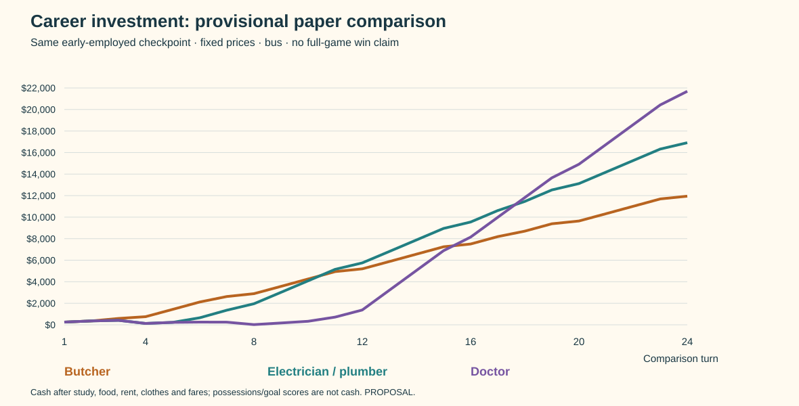

# Career budgets v1: earn early or invest longer?

2026-10-17. **PROPOSAL / analytical worksheet — not approved balance, measured gameplay or application implementation.** This puts provisional numbers against the [career graph](career-and-town-graph-v2.md): Butcher, Electrician/Plumber and Doctor. It exposes tradeoffs and funding problems before selecting the first playable scope.

## What the first comparison says

Butcher delivers useful earnings first. A trade overtakes it later. Doctor requires substantially longer study and an intermediate support job, then has the highest long-run earnings under these proposed wages. This is the intended *shape*, not evidence that all strategies have equal chances of winning.

[Zoomable chart SVG](../../artifacts/planning/career-comparison-v1/cash-comparison.svg). Cash is after modeled food, rent, clothes, tuition and fares. It is not Happiness, Career, net worth or total goal completion.

| Baseline, bus travel | Butcher | Electrician / Plumber | Doctor |
| --- | ---: | ---: | ---: |
| Completed courses for target job |1 |2 |4 |
| Tuition paid |$50 |$100 |$200 |
| Total study time, before visits |60 |120 |240 |
| Target displayed hourly wage |$12 |$18 |$30 |
| Gross full six-time shift |$96 |$144 |$240 |
| Qualification completed, comparison turn |3 |5 |11 |
| First target-job hire, comparison turn |4 |7 |12 |
| Lowest **end-turn** cash, excluding initial$200 |$254 |$124 |$20 |
| Cash after turn8 |$2,889 |$1,953 |$20 |
| Cash after turn12 |$5,197 |$5,749 |$1,375 |
| Cash after turn24 |$11,949 |$16,917 |$21,691 |
| Original Education reference score |10 |19 |37 |
| Original Career reference at turn24 |60 |70 |90 |

The two trades are deliberately identical financially in this first test. Their future workplace locations, offers and economic exposure could distinguish them; no claim is made about real-world pay equivalence. Doctor's$30 and trades'$18 are new illustrative wages; Butcher's$12 is an original base-wage anchor. All figures are fictional game currency, not a real wages/tuition comparison.

With this particular schedule, trades first exceed butcher cash on turn11; doctor first exceeds butcher on16 and trades on18. Those crossings depend on tuition, upkeep, intermediate work, route allowances and hiring policy. A short race can favour early earnings long before the longest-horizon line wins.

## A controlled starting point, not the opening game

All rows start at the **same hypothetical early-employed checkpoint**: cash$200; checkout-like service job at$8/hour; actual experience22, dependability25 and growth ceiling30; six casual-clothing units; no dress clothes or vehicle; no courses completed; first modeled rent due on comparison turn4. These are controlled worksheet inputs, not a recovered original save or the original fresh-game allocation. Comparison turns are not promises of campaign weeks from clicking New Game.

The original starts unemployed. Its Cook entry has a growth ceiling20; one qualification adds5 to that ceiling, so Cook work alone caps experience25 below Butcher's30 requirement. Graduation adds a growth credit, not5 actual experience. An intermediate job such as checkout work can bridge it. The shared employed checkpoint isolates the education decision *after* that opening; it deliberately leaves the opening's job search, clothing/food choices, costs and delays outside the totals. See [employment](../rules-audit/employment.md) and [education](../rules-audit/education.md).

**Recommended successor interpretation:** Trade School is the only course needed for Butcher, but earning enough work history can still involve an intermediate job. Show the experience requirement and a useful next step. If we instead want a direct Cook→Butcher guarantee, changing the starter growth ceiling is a separate mechanical decision; this worksheet does not silently make it.

## Numbers and assumptions

| Input | Worksheet rule | Basis / limit |
| --- | --- | --- |
| Turn |60 time | Original allowance retained as proposal |
| Work/study |6 per full action; full shift pays8×displayed wage | Original nominal action/pay relationship; partial final actions deliberately unused |
| Courses |10 lessons each; one$50 enrollment per course, paid when its first lesson begins; no lesson fee | Original base-fee/ordinary attendance anchors, frozen rather than economy-generated; successor graph has different subjects |
| Study policy |Up to4 lessons per turn; select the most affordable count, then fill available time with whole shifts | A transparent example policy, not optimal play or an AI implementation |
| Visit allowance |Work and food visit each turn; school if studying; extra visits for rent, clothing or first bike purchase. Each reserves a two-edge trip plus entry | Bus6 time/$3 per visit; bike5 time/$0. No end-turn return home. Fixed budgets are **not a mapped town itinerary** |
| Food |$79 each turn | One simple fast-food spending allowance anchored to original hamburger base price; no fridge purchase/storage simulation or separate Happiness benefit |
| Rent |$325 on turns4,8,12,16,20,24; an extra visit each time | Initial contract anchor and regular four-turn budget; no extensions, arrears or garnishment |
| Clothes |Casual$73 adds11 duration, smart/dress$125 adds13; six casual units initially; positive grades decay from turn2 | Original nominal stock/price anchors. Doctor's smart/dress requirement is new provisional job data. Correct clothes purchased before work |
| Work history |Per shift+1 experience/dependability while below caps; end-turn−3 dependability; graduation+5 dependability and+5 to each growth credit | Selected original rules; no graduation credit is counted as actual experience |
| Hiring |At turn opening, check courses, experience and dependability; successful change costs4 time, adds2 experience and resets the job ceiling | Eligible hires succeed in the baseline. No default vacancy probability is being claimed |
| Prices/economy |Constant nominal figures | No economic swings, stochastic prices, shocks, raises, interest or taxes; these are later validation requirements |
| Other possessions/goals |No laptop, books, home shift, relaxation or shopping rewards | Isolates career investment; does not claim a complete winning strategy |

The money order matters: fares, necessary clothing and bike purchase must fit opening cash; shifts earn before tuition, food and rent are settled. Tuition can fund the next sequential course in the same school visit after the previous one completes. All paid actions and visits fit60; cash cannot go negative. Graduation happens after the work block, so its credits only help subsequent work. The policy waits until next turn to apply after new eligibility; a cleverer in-person sequence could hire sooner.

Food, rent and clothes are included; illness, theft, hunger processing, leisure, weekends and all four-goal finish are not. The chart is an **earning-path comparison**, not a claim a player can ignore those systems in the actual game. In particular, retaining the old Education formula gives10/19/37 for1/2/4 courses; the original default target50 needs six completions. All three routes need a later goal-completion plan.

## Proposed job thresholds used in the worksheet

These make work history real rather than treating course completion as guaranteed immediate hiring. Only the checkout-like service and Butcher anchors are original data; new roles are explicit successor proposals.

| Role | Wage | Experience / dependability | Required completed courses | Work clothing |
| --- | ---: | --- | --- | --- |
| Shared service checkpoint |8 |20 /20 |None |Casual |
| Butcher |12 |30 /30 |Trade School |Casual |
| Electrician / Plumber |18 |35 /35 |Trade School + relevant specialisation |Casual |
| Clinic support assistant |10 |30 /30 |General Studies + Science Foundations |Casual |
| Doctor |30 |40 /40 |General Studies → Science Foundations → Medical Studies → Clinical Qualification |Smart/dress |

The doctor route uses the **clinic support assistant from turn6** as paid work while studying. This is a proposed new job, not a clinical-practice simulator or an occupation inferred from original metadata. Its qualification use extends v2's Science Foundations branch and its support-job roster. Without an intermediate earning opportunity, the funding picture changes; do not quote these results as “four courses, no work needed.”

Electrician/Plumber completes study on5 but hires on7: work-history thresholds and the turn-opening application policy delay the transition. More study time alone would not remove that bottleneck. Hiring itself still takes time and can reduce that turn's shifts.

## Sensitivities that change the story

The [480-row ledger](../../artifacts/planning/career-comparison-v1/turn-ledger.csv) includes24 turns ×4 paths ×5 variants; [summary JSON](../../artifacts/planning/career-comparison-v1/summary.json) exposes all outputs.

| Variation | Butcher | Electrician / Plumber | Doctor | Interpretation |
| --- | --- | --- | --- | --- |
| First eligible target application rejected once |Hire5; turn24 cash$11,661 |Hire8; cash$16,293 |Hire13; cash$20,491 |Even one failed opening matters. No probability/win-rate inference from this single specified failure |
|12 time lost on turn4 |Hire4; cash$11,757 |Qualification6, hire7; cash$16,722 |Hire12; cash$21,499 |Busy rent-week disruption; not an original illness event reproduction |
| Buy$120 bike on first turn, including visit |Lowest end cash$76; turn24$11,939 |Lowest$40; qualification6, hire7; turn24$16,849 |Lowest$40; hire12; turn24$21,961 |Early purchase can tighten cash; three time saved across three visits often does not create another **whole** shift |
| Keep at least$100 at turn end before extra study |Same base results |Same base results |Lowest$124; qualification11 and hire12 unchanged; turn24$21,691 |Pausing before a new course/payment around rent week smooths cash without delaying the medical payoff in this case |

The bike's modest result on short averaged routes is a finding about this fixture, **not proof the bike is bad**. It charges its purchase, costs a visit, excludes partial shifts and does not optimise journeys or shopping frequency. Longer/different layouts, walking comparisons, useful leftover time, cars and actual food storage need separate route tests. Do not cut its price just to force a preferred outcome before selecting the map.

The$100-buffer variant means a closing-cash rule, not a guarantee of$100 at every instant. It delays some study/enrollment until obligations are covered; no grant, loan, cheaper rent or extra work time is introduced.

## Recommendations from this pass

1. **Retain Butcher as a strong early route.** Make work-history progress visible; do not bury the old Cook ceiling behind misleading rejection text.
2. **Keep paid work alongside every education branch.** The clinic support bridge is worth developing. Trades already allow ordinary jobs while studying; no unpaid apprenticeship subsystem is needed.
3. **Do not call the wages balanced yet.** Doctor dominates sufficiently long fixed-price cash accumulation; validate short games, economic setbacks, Education/Career/Happiness and varying goal targets before adopting30/18/12.
4. **Keep tuition simple first.** Lost earning time and ordinary upkeep already create a medical investment period; higher fees are not automatically needed to make it feel difficult.
5. **Help players see upcoming rent and preserve a buffer.** A clear obligations reminder and truthful costs may work better than a new rescue/debt mechanic.
6. **Choose the town layout next.** Compare13 versus15 stops with actual routes and short/long commutes. Then rerun representative visit budgets and update the town/college/offer mockups. Map-dependent transport costs remain provisional.

Still needed before the first playable scope is agreed: actual opening route, selected map distances, expanded job data, Education scoring, selected compatibility details, and the interactions with offers/useful devices. This worksheet narrows those choices; it does not start application implementation.

## Reproduce and inspect

- [Inputs](../../artifacts/planning/career-comparison-v1/inputs.json), [summary](../../artifacts/planning/career-comparison-v1/summary.json), [turn ledger](../../artifacts/planning/career-comparison-v1/turn-ledger.csv), [SVG](../../artifacts/planning/career-comparison-v1/cash-comparison.svg), [PNG](../../artifacts/planning/career-comparison-v1/cash-comparison.png).
- [Worksheet tool](../../tools/research/compare_career_budgets.py): `python3 tools/research/compare_career_budgets.py` regenerates JSON/CSV/SVG; `--check` recomputes the budget rows and compares them with committed records.
- PNG is a display copy of the SVG, rendered with the bundled sharp library; SVG is the directly reproducible chart. Its source has no external font/image dependencies.
- Checks cover nonnegative cash, time≤60, row-level cash conservation, complete course paths/target hires, mirrored trades and exact fixture regeneration. An independent read-only review found no blocking arithmetic/qualification defect in the stated fixture. No game execution, family playtest or original/successor engine equivalence is claimed.
