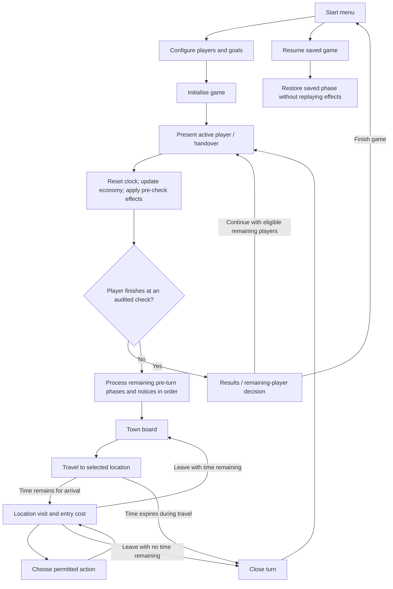

# Game flow and layout outline

Draft: 2026-10-15. **PROPOSAL for planning and wireframes, not an approved interface specification.** This outline fills a documentation gap identified in the [consistency review](consistency-review.md). It does not implement the application or settle remaining game rules.

**Superseded as the starting point:** the owner subsequently requested documenting the original first. Use the [original-game baseline](../original-game/README.md) and its [source-based flow/layout](../original-game/town-and-screen-layout.md). This earlier proposal is retained as history. In particular, its ready/privacy handover, status-bar composition, and possible replacement location view are not established original behaviour.

## Status and terminology

- **Required:** directly supported by the owner's brief: near-original simplicity, humour, economic swings, shared-device multiplayer, and a computer opponent.
- **Script-supported:** original mechanics recorded in the [rules audit](../rules-audit/README.md), still subject to its evidence limits.
- **Proposed:** interface organisation suggested here.
- **Open:** a question to resolve before implementation.

Use **week** for a round of player turns, **turn** for one player's allowance and actions, **visit** for entering a location, and **action** for an individual operation. A visual summary may combine messages, but must preserve their effect ordering. Engine time spent and player-facing time remaining are two views of the same allowance.

## Proposed overall journey

The setup, handover, menu, and results screens below are proposed. Turn boundaries and the visit loop are informed by TIME/WEEK rules. Original first-week and finish/removal exceptions still need a complete audit.



The diagram abbreviates calculation and presentation. Pre-turn effects must remain in the order recorded in WEEK-002; interactive notices can be interleaved with processing. It does not move victory checks to the end of the notice sequence. Resume must restore the saved phase rather than unconditionally start a fresh turn. Exact supported save phases remain open.

Open: setup defaults, player counts/combinations, whether there is a voluntary end-turn control, finish options, and how Jones's turn is shown. A voluntary end-turn action is not established by this audit and is not introduced by the diagram.

## Proposed screen inventory

| Screen / view | Must communicate | Main interactions to specify |
| --- | --- | --- |
| Start / resume | New game, existing local save, basic premise | Start, resume, settings; save handling open |
| Setup | Who is playing, human/computer roles, chosen goals | Choose players/characters/goals; limits/defaults open |
| Handover | Whose turn is next, current week | Proposed ready acknowledgement; privacy and PC-turn variant open |
| Turn notices | What happened, whom it affects, resulting changes | Read/advance; presentation must preserve rule ordering |
| Town | Destinations, active player, cash, remaining time, progress access | Select destination, inspect status, open menu |
| Location | Character, available services/items/jobs, costs and outcomes | Location actions, work if eligible, leave |
| Employment | Offered jobs/wages, requirements, current job/wage | Apply, request raise, understand refusal |
| University | Available courses, prerequisites, enrollment, study progress | Enroll, study, understand locked options |
| Home / possessions | Visible ownership, relevant benefits and duration | View possessions; exact home services open |
| Goals / player comparison | Progress toward victory and each player's standing | Inspect own/other public status; visibility rules open |
| Game menu | Save/resume behaviour, sound, message pace, controls | Configure and save; exact supported actions open |
| Finish / results | Who achieved which goals; whether others continue | Continue or finish as agreed after full goal/finish audit |

Screens may share templates or overlays; the table defines player tasks rather than mandatory separate routes. Employment and university need dedicated information layouts even if they occupy the same location-view frame.

## Proposed desktop/tablet composition

**PROPOSAL:** keep the town recognisable and the controls consistent. These regions are not a claim about exact original placement.

```text
+--------------------------------------------------------------+
| Active player / portrait       Week       Menu and status     |
+--------------------------------------------------------------+
|                                                              |
|                  Illustrated town board                      |
|          Distinct storefronts + travelling token              |
|                                                              |
+--------------------------------------------------------------+
| Cash on hand       Time remaining       Goal progress access  |
+--------------------------------------------------------------+
```

For a location visit, retain the same player/time/cash frame. Use the main area for a character/interior and readable offers/actions. A consistent leave control returns to the town, subject to TIME-002. Decide through wireframes whether the visit replaces the town or overlays it; no choice is approved here.

Do not expose raw economic reading/index numbers merely because the audit identifies them. Whether the new game reveals more than prices, wages, and event news is an adaptation decision.

Open: final board topology, number of buildings, original spatial relationships, landscape priority, phone support, exact proportions, typography, art resolution, and animation. A responsive layout must not quietly change travel costs or hide required actions.

## Interaction contract to complete for every screen

For each visible action, specify:

1. What the player sees before acting: price, time cost, prerequisites, and relevant state.
2. What selection does, including travel versus entering, or selecting versus purchasing.
3. Whether the action is available with partial or zero time, and why it can be refused.
4. Money/time/progress changes and the feedback that explains them.
5. What happens on leave, interruption, save/restore, or turn completion.
6. Keyboard/touch operation, focus order, readable text, and status cues that do not depend only on colour.

Avoid treating all timed actions as disabled when their full nominal cost cannot fit: TIME-003 records partial-time behaviour. Likewise, exhausting the clock inside a visit must not automatically dismiss that view if eligible free actions remain.

## Walkthroughs needed to validate the design

- New player: setup → first notices → find job → work → buy food → leave → next player.
- Advancement: inspect a better job → understand missing qualification → enroll/study → return to apply.
- Boundary: last hour at a workplace → prorated shift → time-free transaction → leave and hand over.
- Shared event: active player triggers a crash → consequences identify each affected player → next turn begins correctly.
- Completion: a player reaches goals → appropriate boundary check → results → remaining-player choice.
- Resume: save at an allowed phase → reload → no duplicate weekend charge, economic update, or action effect.

These walkthroughs are proposed design checks, not completed runtime tests. Actual starting resources, requirements, and victory semantics must come from the completed audit and agreed adaptation.
