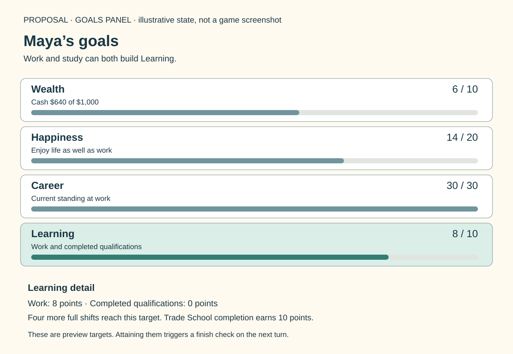

# Learning: a goal for working and studying

2026-10-17. **PROPOSAL — exact scores, growth rules and thresholds are unapproved.** The owner endorses developing the Learning direction so ordinary work-first careers are viable alongside trades and professions. This makes the earlier [Learning recommendation](town-layout-and-work-first-routes.md#education-goal-versus-career-entry) concrete; that direction does not approve this exact formula, thresholds or application implementation.

## Recommended small model

Replace Education with **Learning**, recognising both time doing useful paid work and completed qualifications. Keep the same four visible life goals: Wealth, Happiness, Career and Learning. No additional training bar, skill tree, apprenticeship currency or collection of job-family meters.

| Source | Proposed Learning credit |
| --- | --- |
| Successful work | 1 point per 12 actual time units worked; a normal six-time shift contributes half a point |
| First completion of a qualification | 10 points, once per stable qualification ID |
| Applying, being hired/promoted, requesting a raise or accepting an offer | None |
| Buying, owning, selling or repurchasing a possession | None |
| Failed/refused work, travel, shopping, waiting or leisure | None |

Let `W` be lifetime successful work time and `C` the number of unique completed qualifications:

**Learning = min(100, floor(W / 12) + 10 × C).**

Keep fractional work progress internally as the integer `W`; calculate the score from the total instead of rounding each shift separately. The goal panel can say “Learning 24 / 50 — work or finish courses” and “Next work point: 6 time.” This is explanatory text inside the existing goal panel, not another visible meter.

Work is counted regardless of wage, seniority or employer. A garnished shift still represents work; a higher wage does not multiply Learning. Eligible laptop home shifts count exactly like workplace shifts. Entry-level work remains a slower but complete route to 100 even without changing jobs. A target of 100 is supported, not necessarily the recommended first-playtest target.

The original partial-last-lesson rule is not changed here: a lesson near turn end can still advance a full lesson step while consuming less than six remaining time. That can make a qualification cheaper in elapsed time. Its 10-point reward is still once per qualification, but this proposal does not claim to remove every study-time optimisation or farming tactic. Study gives no partial Learning points before graduation; the existing course-progress display explains its pending reward. Under the current worksheet's ten six-time lessons, a course earns 10 points for 60 study time, versus 5 points from 60 work time. That intentional study advantage costs tuition and forgone earnings. A useful study device can shorten the course while retaining its qualification reward; buying the device alone earns no Learning.

This is a deliberate replacement for the earlier distinct-workplace-skill milestone suggestion. Per-role or per-family caps would push players into unrelated job swaps to complete Learning. Cumulative useful work avoids that menu tourism. Courses retain their distinctive purpose: **Learning points never satisfy a named qualification prerequisite.** A Learning-100 bank manager still needs the medical courses to apply for Doctor.

## Worked examples

These are action totals, not complete campaign budgets or promises of turn counts. Travel, job searches, food, rent, leisure, study funding and setbacks still consume time/money.

| Route | Successful work | Completed study | Learning |
| --- | ---: | --- | ---: |
| Work only, halfway target | 100 full shifts = 600 time | None | 50 |
| Work only, maximum target | 200 full shifts = 1,200 time | None | 100 |
| Mixed practical route | 80 shifts = 480 time | Trade School, 10 lessons / 60 time in current worksheet | 40 + 10 = 50 |
| Two-qualification route | 60 shifts = 360 time | Trade School + Electrical Skills, 120 study time | 30 + 20 = 50 |
| Professional route | 20 shifts = 120 time | Four medical-branch qualifications, 240 study time | 10 + 40 = 50 |

A six-time lesson and a six-time shift have the same nominal time budget, but different rewards: the shift pays immediately and contributes half a Learning point; a standard ten-lesson qualification pays no wages and contributes 10 points on graduation. The medical row is a scoring example, **not** proof that 20 shifts can fund that route; the [career budget](career-budget-comparison-v1.md) and [mapped follow-up](town-layout-and-work-first-routes.md) show why paid intermediate work matters.

At an illustrative six successful shifts per turn, work-only Learning 50 takes about 17 working turns and 100 about 34. This is arithmetic, not a session-length forecast: an ordinary game also needs leisure, errands, rent, changing conditions and actual hiring. We should test whether that pace feels rewarding before adopting it.

## Career must also be reachable without college

Fixing Learning alone would leave a second education dependency. The [audited employment rules](../rules-audit/employment.md#emp-006-work-progression-income-and-education-integration) use graduation credits to extend experience and dependability growth ceilings. The provisional no-course senior management jobs have declared dependability 45; without credits their dependability ceiling is 65. After the original three-point outgoing-turn decay, 62 only gives Career 70 under the original stepped formula. A work-first player could complete Learning yet remain unable to maintain a high Career target.

Recommend replacing graduation-only growth credits with a common **Learning-derived growth allowance**:

**growth allowance = 5 × floor(Learning / 10).**

Use that value in both original growth-ceiling positions:

- Experience ceiling: current job's base experience ceiling + growth allowance.
- Dependability ceiling: current job's declared dependability + 20 + growth allowance.

Do **not** add the old +5 experience/dependability *ceiling credits* again at graduation. One qualification normally moves Learning by 10 and thereby supplies the same five-point ceiling extension; sustained work can now supply it too. Never add five again when re-entering a job, reopening a diploma or loading a save. This allowance increases room to grow, not actual experience, actual dependability, wages, job eligibility or Career immediately.

At Learning 40 the allowance is 20. A declared-dependability-45 senior work-first role can therefore grow to 85 dependability, retain 82 after the three-point decay and sustain Career 100 while employed under the original `min(100, 10 × floor(dependability / 8))` formula. Reaching that level still requires successful work, the job's requirements and maintaining dependability. It is not granted on gaining Learning. This demonstrates an attainable ceiling, not an opening-game route proof.

It can also change the early Butcher route. Learning 20, earned through work plus one course, gives a ten-point allowance: the original Cook base experience ceiling of 20 could then rise to 30, meeting Butcher's experience threshold. The earlier cash worksheets required an intermediate checkout-like job under their old graduation-only model. Do not treat that step as mandatory under this proposal; validate a fresh Cook → Trade School → Butcher route, including dependability, clothing, hiring and actual time/cash.

**Learning measures accumulated development; Career measures current work standing.** Learning is permanent. Career can fall after unemployment or neglect. Moving between jobs in the same family, or entirely different families, neither resets nor duplicates Learning. There is no need to classify every role into a new scored skill family.

This proposal replaces the original graduation ceiling credits only. Recommend retaining the separate original graduation +5 Happiness and +5 actual-dependability effects for completed courses as provisional compatibility defaults; they are distinct from the replaced ceiling credits and remain unapproved. Work milestones add neither bonus. The current cash worksheets use the old graduation growth model and do **not** model this Learning allowance, new work-first growth, all-goal victory or the following proportional-history rule. Their cash lines must not be quoted as validated results under this proposal.

## Partial actions and simple safeguards

- **Actual time, not Work clicks:** credited work time must be positive and no greater than the available turn remainder; if only two time remain, successful work adds two to `W`, not six. Three such partial shifts earn the same Learning as one full shift. Starting work at zero available time adds nothing.
- **Work history follows the same effort:** also replace the original per-click +1 experience/dependability with one capped growth step per six successful work-time units. Earned steps for an action are `floor(Wnew / 6) − floor(Wold / 6)`; the carried 0–5 remainder is derived as `W % 6`, across shifts and employers, rather than stored separately. Consume each full step even when a ceiling blocks growth; do not bank blocked growth for a later promotion. This is an explicit original-rule departure needed to avoid partial-shift Career farming alongside fair Learning.
- **One committed action:** validate work, determine actual time/pay, add work time, derive Learning/growth allowance, then apply the earned work-history steps against the resulting current-job ceilings. Persist the complete result atomically. Qualification completion likewise updates the unique completion set and derived allowance once.
- **No job-swap bonus:** hiring and offers may retain other agreed effects, but add no `W` or qualification completion. Promotions never reset `W` or yield milestone credit again.
- **No sale/reload bonus:** equipment assists study or work as specified elsewhere; sale does not erase achievements. Reopening course screens and restoring a save only reconstruct derived values, never replay rewards. A restored earlier save restores earlier totals; it does not merge progress from an abandoned future.
- **Same human and AI rules:** all participants earn from legal successful actions, actual work time and the same qualification IDs. Difficulty does not secretly multiply Learning or growth allowance.
- **Versioned state:** save `W`, unique qualifications and normal course progress with the rules version. Derive the goal, growth allowance and work-history remainder from those values on restore; do not persist redundant remainder state. Reject duplicate qualification IDs in imported data. Save-format/migration implementation waits for the agreed architecture.

This is ordinary local-game consistency, not a competitive anti-cheat service. No backend or leaderboard validation is introduced.

## Focused validation before adopting the numbers

| Check | Expected result |
| --- | --- |
| Ten normal shifts, versus their 60 work-time units split across partial actions | Learning 5 in both cases; ten work-history steps before job caps |
| 100 normal shifts, no qualifications | Learning 50 |
| 200 normal shifts, no qualifications | Learning 100; further work cannot raise it above 100 |
| 80 normal shifts plus first Trade School completion | Learning 50 |
| Course completed twice through duplicate notification / save restoration | One 10-point credit; no duplicate growth allowance |
| Swap jobs repeatedly without working | Unchanged Learning, no growth allowance change |
| Learning crosses 9 → 10 from work | Allowance rises 0 → 5; no free actual dependability, qualification or Happiness |
| Work-first senior role at Learning 40 | Ceiling permits dependability 85 and outgoing 82, enough for Career 100 while employed |
| Same work sequence with a low wage, high wage or garnishment | Same Learning; payroll differs |
| Human and computer execute the same legal actions | Identical Learning, allowance and work-history results |
| Laptop shortens a course | Same unique qualification reward; no reward from purchase itself |

These are specified acceptance cases, not executed engine tests. No new test/application code is included in this document.

**Next review:** use Learning 50 as a provisional first-playtest target and compare both work-first management and Trade School → Butcher across all four goals. Check pace, achievement feedback and whether courses become an obligatory shortcut in practice. Change the work denominator or course reward together if one route dominates; do not respond by requiring every worker to collect degrees or visit unrelated employers.

## Review artifacts and reproducibility

[Zoomable panel source](../../artifacts/planning/learning-panel-v1.svg). This is an original wireframe, not an implemented screen or captured save. The synthetic example has `W=96`, no qualifications and Learning8; four further full shifts add24 time and reach Learning10. Its other scores are illustrative, not a tested campaign.

Run `python3 tools/research/check_learning_proposal.py --check` from the repository root to verify the committed [arithmetic and old-schedule overlay](../../artifacts/planning/learning-coverage-v1.json). The checker covers eleven arithmetic cases and overlays the score on45 completed mapped-budget schedules, recording the source ledger hash. It does **not** recompute hiring, growth ceilings, cash or actions under the new rules. For example, the fixed map-A bus schedules first cross Learning50 in turns11–16; those are retrospective score crossings, not successor win times or balance evidence.

The [first playable scope](first-playable-scope.md) proposes a smaller Learning10 preview target so one qualification or twenty full shifts can exercise the new goal. Learning50 remains the longer-route comparison target above. Both presets and this formula remain proposals; validate real fresh-opening journeys before adopting either.
