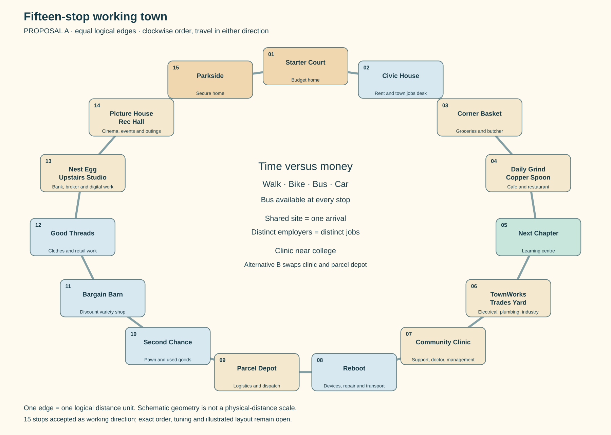
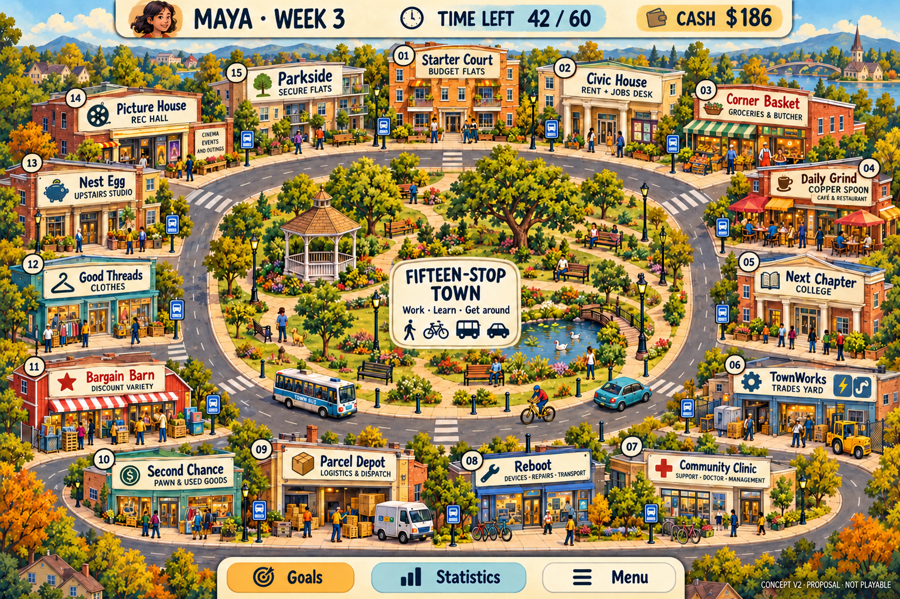

# Fifteen stops, and more than one way to get ahead

2026-10-17. The owner accepts **more stops**, so use15 as the working board size rather than continue a13-versus15 selection. The owner also clarifies that education must not be the only career route: burger/food work, bank teller and other ordinary jobs should remain meaningful paths. **Exact locations, job thresholds, costs, Learning rules and illustrations below are proposals.** No application implementation is approved.

## Proposed town A

[Zoomable SVG](../../artifacts/planning/town-layout-v1/town-map-a.svg) · [Alternative B schematic](../../artifacts/planning/town-layout-v1/town-map-b.svg) · [Exact input/order](../../artifacts/planning/town-layout-v1/inputs.json).

The proposed clockwise order is Starter Court → Civic House → Corner Basket → Daily Grind/Copper Spoon → Next Chapter → TownWorks/Trades Yard → Community Clinic → Reboot → Parcel Depot → Second Chance → Bargain Barn → Good Threads → Nest Egg/Upstairs Studio → Picture House/Rec Hall → Parkside → back to Starter Court. Routes may travel either way around the ring.

**Why this order:** budget housing has nearby ordinary work, food and civic services. Trades and clinic work sit near training without all being next door to home. Clothes, used goods and discounts create a different errand circuit. Bank/studio work and leisure remain distinct destinations. Secure housing is not automatically the best commute for every profession.

Every adjacent pair is one **logical** distance unit; the drawing is a schematic, not scaled road geometry. A15-node ring has maximum shortest-route distance7. A shared site has one arrival/entry, but its employers keep distinct jobs and rejection memory. Civic House's job desk remains usable outside rent-service periods. Selecting its rent tab does not invent another travel stop. Exact service-menu flow still needs a wireframe review.

Alternative B swaps the clinic with Parcel Depot. This is a comparison of two fifteen-stop placements, not a request to choose the town size again. Recommend A: it leaves more time for a clinic worker to combine work and study. The rest of the expanded employers remain available in both.

### Illustrated concept v2

Generated with the built-in image_gen tool, using the earlier original concept for style and schematic A for order; [exact prompts and input roles](../../artifacts/planning/town-layout-v1/visual-prompts-v2.json) are committed. A targeted edit corrected the Second Chance badge from11 to10. Visual inspection confirms all15 named stops in the proposed clockwise sequence, including butcher signage, trades, clinic, parcels, banking/studio and hospitality. The HUD now says Time Left. Neither image nor names are final art/branding.

The illustrated scene is an art/layout exploration, not an application screenshot or a scaled distance map. Decorative garden paths are not additional routes; the analytical ring remains the cost reference. Judge readability at tablet size before producing assets; a single composite does not supply separate sprites, character poses, accessibility or a complete interface.

## Work-first careers are first-class paths

The [previous numeric comparison](career-budget-comparison-v1.md) intentionally isolated three qualification-led routes. It is not the whole career design. The new route worksheet adds two **no-course** career ladders, alongside butcher, trades and doctor.

| Proposed work-first family | Illustrative path | Advancement rule |
| --- | --- | --- |
| Food service | Counter/cook work → shift supervisor → venue manager → senior venue manager | Experience and dependability; no formal course gate for this management route |
| Banking | Service work → bank teller → supervisor → branch manager | Work-history-led entry and progression; no college gate for this proposed teller/management branch |
| Retail, logistics and campus/housing services | Entry work → experienced worker/supervisor → relevant manager | Same design direction; complete numeric job records still to draft |

Chef, electrician, doctor and other specialist work can require specific qualifications without imposing them on every earning path. The hospitality management path is distinct from the qualified-chef path; a manager does not have to be a chef first. Bank investment/professional specialist roles can have their own training requirements without making all teller work a college career.

**Explicit departure:** original Teller required course14 and experience/dependability40/40. The new worksheet proposes no course,25/25 entry and wage10, then35/35 supervisor at14 and45/45 branch manager at19. Food supervision/management uses25/25 at10,35/35 at14 and45/45 at18. These are provisional **new jobs**, not findings or owner-approved thresholds. They deliberately bridge the original growth ceilings through successive jobs.

Personal offers can acknowledge sustained ordinary work: a dependable counter worker can be recruited into restaurant supervision without being told to go back to college. Ordinary qualified applications still use the same underlying rules at employer or civic desk. Offer frequency, premiums and reserved openings remain separate proposals from the [offers review](employers-offers-and-useful-possessions.md).

### Education goal versus career entry

The original Education goal counts course completions, so removing course gates from jobs alone does not create a course-free way to win a game that still requires that goal. The worksheet leaves its reference Education score unchanged and consequently reports0 for the work-first paths; this is a limitation to resolve, not a proposed punishment for those players.

**Recommendation for review:** call the goal **Learning**, recognising both completed courses and substantial workplace-training/mastery milestones. Reuse the existing qualification/achievement presentation rather than add a second visible training meter. Workplace credit should require sustained useful work and be awarded once per distinct skill, not every application, promotion or job swap. Classroom study remains the route to specialist qualifications; general Learning progress does not magically qualify someone as a doctor.

Weights, milestone definitions and configurable targets still need design. This document does not adopt a score formula or claim work-first paths already satisfy all four goals. That decision is necessary before a complete first-playable win test.

## Mapped travel, rather than average visit allowances

The [transport proposal](transport-proposal.md) supplies the provisional formulas: walk3d, bikeceil(1.5d), bus2+d, car1+ceil(d/2); each arrival adds2 entry. Bus costs3 per leg; car costs4 per leg plus20 on its first use in the personal turn. The following tours start at Starter Court and end at Hospitality for the worksheet's79-dollar food allowance; no return-home leg is charged because the retained turn model begins the next turn at housing.

| Work → college → food tour | Leg distances from home | Walk time | Bike time | Bus time / fare | Car time / first-use operating cost |
| --- | --- | ---: | ---: | --- | --- |
| Butcher at Corner Basket |2,2,1 |21 |14 |17 /$9 |12 /$32 |
| Electrician/plumber at TownWorks |5,1,1 |27 |18 |19 /$9 |14 /$32 |
| Clinic support/doctor |6,2,1 |33 |20 |21 /$9 |14 /$32 |

All totals include three entries. Car/bike ownership purchase costs are **not** included in these operating-only tours. A car is not an affordable opening assumption. A player can walk every route within a fresh60-time turn, but doing work/study as well changes which choices fit. The bus remains a reliable fallback with no vehicle gate on work.

At six time per full action, those bus tours leave7/6/6 whole work-or-study actions. A car leaves8/7/7 at a higher financial cost. A bike leaves7/7/6 without fares. Full-action rounding is conservative: partial work/study can make leftovers useful in the eventual adopted rules.

On a rent week, the fixed order work → college → Civic House → food increases bus time to25/27/29 and fare to12. Non-study work-and-food bus tours are11/15/17 and6 in fares. A food-service employee can eat at the same site as work without travelling or paying entry twice. We have not silently optimised tours by moving obligations, combining shopping frequency or changing food storage.

Phone information, food storage, a home shift and better errand planning could change a real player's trip pattern. This pass does not grant those benefits for free or invent remote ordinary work for a cook/plumber/doctor.

## Career worksheet rerun with these routes

The same early-employed checkpoint, pay/study/stock rules and24-turn horizon from [v1](career-budget-comparison-v1.md) are retained. Only its fixed visit allowances are replaced with ordered, shortest-ring trips. Both new work-first examples also begin at that shared8-dollar checkout-like service checkpoint with experience22/dependability25, **not** at an unemployed burger opening.

| Map A, bus baseline | Target role reached | Lowest end-turn cash | Cash after24 turns | Courses completed |
| --- | ---: | ---: | ---: | ---: |
| Food-service management |6 |$627 |$19,579 |0 |
| Bank management |7 |$627 |$17,624 |0 |
| Butcher |4 |$254 |$11,757 |1 |
| Electrician / Plumber |7 |$60 |$14,261 |2 |
| Doctor |13 |$9 |$16,270 |4 |

The work-first figures target the final management role; ordinary food work and teller employment occur earlier. In this fixture food supervision begins2, venue management3 and senior management6; teller2, banking supervisor4 and branch manager7. These are example-policy comparison turns, not guaranteed opening-game timings.

This changes the earlier impression that the doctor must lead long-run cash: the no-course management paths are financially strong under these proposed wages, location costs and full-shift policy. Food work also benefits from having work and the food purchase at one site. **No route is declared balanced or a winning strategy.** Learning/Happiness, actual vacancies, economic swings, fresh-game setup, promotion choices and other purchases remain outside the model.

### What the harder cases expose

- Clinic A yields21 bus travel/entry time for the study tour; Clinic B yields24. The plain doctor worksheet ends24 with16,270 on A versus14,350 on B. This is one specified policy, not proof a clinic must be adjacent to college.
- A100-dollar closing-buffer policy on A keeps the doctor above105 at turn end, with final hire still13 and turn24 cash16,283. It pauses some study rather than borrowing or granting money.
- Buying a120-dollar bike immediately is a **long acquisition trip** to Reboot, followed by the rest of the errands. It leaves only12 at the first turn end in the unbuffered baseline. The acquisition visit is charged; no free opening bike is assumed.
- The aggressive doctor/bike fixture fails on turn13 in A and8 in B under the unchanged v1 policy; B's buffered-bike case also fails on8. The worksheet forces an eligible promotion/clothing purchase and does not search recovery decisions. **This is an unfunded fixed plan, not a gameplay softlock or proof that studying with a bike is impossible.** A player could postpone the bike, promotion, clothes or studies, or work more. Failed-case partial ledgers are not presented as completed runs.
- Buying a bike with a100 closing buffer completes the doctor path on A, hiring14 and ending24 with15,065. It demonstrates a feasible alternative under the same costs, not optimal bike timing.

Car acquisition/payback, mixed-mode selection, cheapest-food strategies and residence changes are not in the24-turn career runs. Parkside tour comparisons are supplied separately; they do not include paying for the better housing. All fares are reserved from opening cash, conservatively including post-work journeys. The original v1 fixtures still regenerate unchanged.

## What is ready next

Use A as the recommended arrangement for the next illustrated concept, while retaining B as a comparison. Review the job-first and specialist routes together. Then decide the Learning-goal direction and the minimum slice that tests finding work, working, earning a promotion or qualification, transport, a useful purchase and rent. A solo slice need not implement every professional branch, but its design must accommodate both work-first and classroom routes.

## Rebuild and evidence scope

- [Inputs/order and proposed work-first job data](../../artifacts/planning/town-layout-v1/inputs.json), [144 tour cases](../../artifacts/planning/town-layout-v1/journeys.json), [career summaries including failed-plan statuses](../../artifacts/planning/town-layout-v1/career-summary.json), [1,080 completed-run ledger rows](../../artifacts/planning/town-layout-v1/career-ledger.csv).
- Run `python3 tools/research/compare_town_routes.py` for JSON/CSV and both SVG maps; `--check` recomputes comparisons. PNGs are display copies rendered from the SVGs with sharp.
- [Tool](../../tools/research/compare_town_routes.py) supplies the actual-route callback to the bounded [v1 worksheet](../../tools/research/compare_career_budgets.py). It is analytical planning code, not the application simulation. V1's480 rows/20 summaries remain unchanged under its own `--check`.
- Checks cover unique15-stop order, symmetric distances bounded0–7, time/cash accounting inherited from the worksheet, and exact regeneration. A read-only independent review checked formulas, shared-site entries, mapped jobs, work-first progression and the failed-plan caveats. No game execution, family test or full balance claim.
