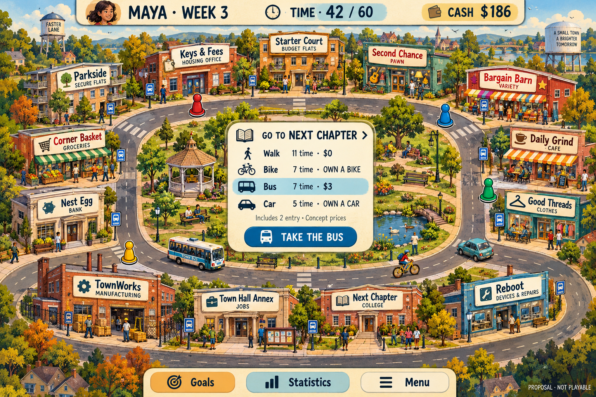
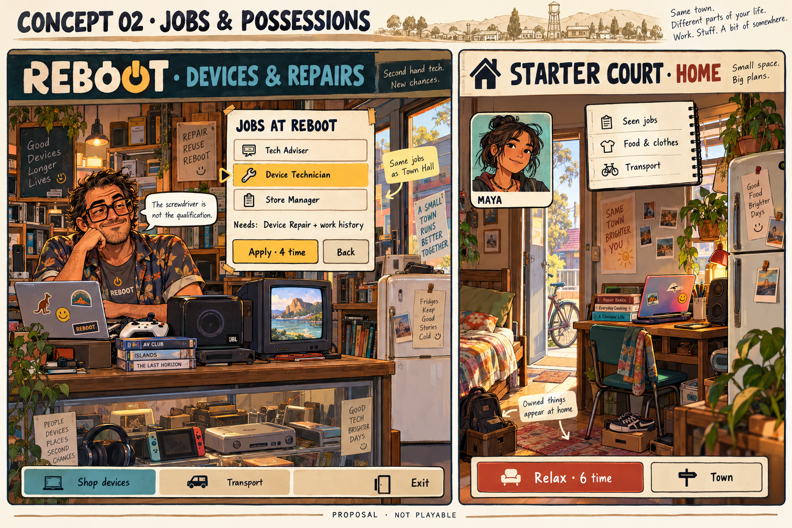

# Visual direction v1: a town finding its next gear

Generated and visually inspected2026-10-17. **PROPOSAL — original generated concept art, not application screenshots, original-game assets or approved final art.** Made with the built-in image_gen tool using the [exact saved prompts](../../artifacts/planning/visual-prompts-v1.json). No original image was supplied as an input. Saved copies live in this repository so the review does not depend on the generating computer.

Read the [modern-direction review](modern-direction-review.md), [transport proposal](transport-proposal.md) and [town/content mapping](modern-town-and-content.md) for the intended mechanics. Words or objects generated in a picture do not add features or override those proposals.

## Town and transport

**What this tests:** whether a compact town can keep the original board identity while giving travel a visible strategic role. The thirteen named destinations appear around the ring in the proposed sequence. New identities include a civic jobs desk, college, café, manufacturing works and devices/repair shop. Bus signs make public transport visible; bike and car cues make ownership desirable.

**Inspection:** the central panel correctly shows the illustrative three-edge inclusive costs11/7/7/5 and bus$3, with two-unit entry stated. All thirteen destinations are represented. Controls and signs are readable at the native image size. The scene is decorative and denser than a final tablet interface should be; we have not measured touch targets or reading at device scale.

**Next revision:** reduce ornamental detail around controls; explicitly label “Time left” rather than the ambiguous “Time42/60”; make unowned modes visibly disabled and use “Requires a bike/car”; highlight a starting marker and the selected route so the quoted distance is spatially verifiable. The current three-edge quote is an illustrative panel, not a demonstrated journey from one identified marker. Show the full first-car-trip charge in a separate owned-car state. A busy screen must not imply simultaneous real-time play or a real-time bus timetable.

No claim is made that the road's drawn lengths match the provisional equal-edge graph. Final geometry and readable scale need review together with transport tuning. The title is a working concept label, not approved branding.

## Shop, local jobs and home

**What this tests:** a character-led visit with a short local job list, alongside the emotional payoff of possessions appearing at home. The proposed Device Technician requirements and four-time application action are visible. The apartment shows laptop, speaker, books, fridge and bicycle; a notebook presents information without promising remote transactions.

**Inspection:** all three proposed Reboot titles are present, with the technician selected. The “same jobs as Town Hall” cue supports a shared underlying job system. The six-time Relax control agrees with the retained action. The shop/home split is a comparison sheet, not a proposal to show two locations simultaneously during normal play.

**Next revision:** use a consistent Maya portrait across both images; make the actual console/media-box ownership visible at home rather than merely implied by shop stock; show clothing and experience requirements in the job detail before finalising the Apply control. The short “Device Repair + work history” line is a summary, not the full eligibility test. Replace incidental recognisable product marks and hardware shapes with a consistent original fictional-device design in the production art pass. The generated book spines do not implement the three-book study-set rule; the approved labels and help must make that relationship explicit.

The warm hand-painted look, large clerk presence, slightly battered devices and lived-in apartment are promising. These images do not settle animation, sound, exact dimensions, accessibility or final character design.

## Review before generating v2

Ask each child and an adult, without coaching:

1. Where would you find a job, apply, actually work and study? Does the employer board make sense alongside the civic desk?
2. Which mode would you use for a cheap short errand and a longer commute? What do you expect buying a bike to change?
3. Which possession would you save for? Is its benefit clear, or are you inferring an effect the proposal does not contain?
4. Does this retain enough of the original game's kitsch, or feel too polished/too crowded? Which storefront or character should be exaggerated?
5. What is missing from this town? Separate a desired job/location from a desire for a whole new management system.

Capture preferences and comprehension separately. V2 should respond to that feedback, with one deliberate style/layout change at a time. Do not generate the full production asset set or start application implementation from approval of one attractive image.

## Validation and provenance

- Built-in image generation; two independent new-image prompts, no image-edit inputs or extracted original pixels.
- Full prompts are committed for regeneration; generative output is not guaranteed to be byte-identical on rerun.
- [Output manifest](../../artifacts/planning/visual-output-manifest-v1.json) records the committed image paths, dimensions, byte sizes and SHA-256 hashes.
- Images were inspected for destinations, labels, mode/time numbers, controls and major visual omissions; qualifications above record limitations.
- The37-job mapping was checked against the research metadata's stable identities and seven numeric requirement/pay fields. Transport trip arithmetic was independently recalculated; neither check is a playable balance test.
