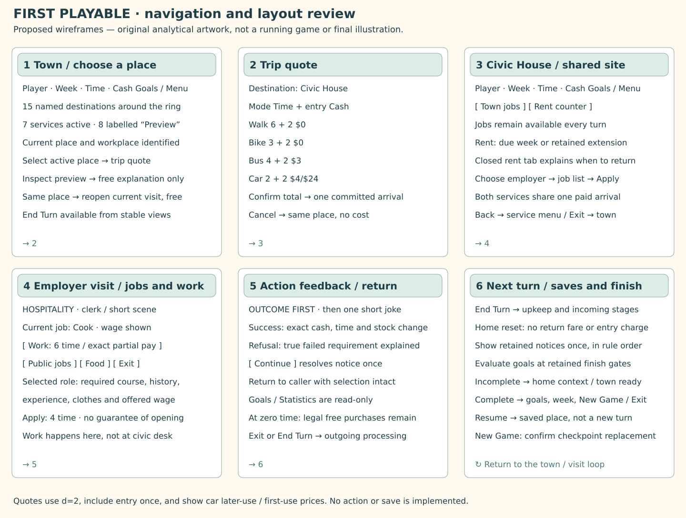

# Whole-pack review: ready for a bounded prototype decision

2026-10-17. **Planning review, not build approval.** Three independent subagent reviews covered progression, rule boundaries and flow/scope; the primary review reconciled their findings against the existing original-game audits. No new gameplay session, original decompilation or application implementation was performed.

The direction is coherent: a small-town race through work, needs, learning and setbacks, keeping the original’s four-goal structure, clerk-led visits and scarce time. The work-first and Trade School routes have reachable progression ceilings under the proposed rules. One real recovery deadlock in the reduced scope was found and a narrow replacement policy is now proposed. This pack is ready for a decision about the first prototype; it is not evidence that campaign balance or all-goal completion has been tested.

## Which documents take precedence

| Question | Current source | Status |
| --- | --- | --- |
| What the owner has chosen | [Brief](project-brief.md), [decision register](decisions.md) | Confirmed direction only; detailed proposals do not silently become decisions |
| What the original did | [Research handoff](original-research-handoff.md), [connected rule contract](../original-game/game-flow-and-rule-contract.md) and linked audits | Evidence-qualified reference; preserved separately from successor changes |
| What the first prototype would contain | [First playable scope](first-playable-scope.md) | Current bounded proposal, superseding the earlier slice in the2.0 draft |
| Learning and work growth | [Learning proposal](learning-goal-proposal.md), C18/C19 | Current cumulative-work proposal, superseding the earlier distinct-skill milestone idea |
| Travel | [Transport](transport-proposal.md) on [map A](town-layout-and-work-first-routes.md) | Fifteen-stop proposal; replaces original residue/C03 and interrupted travel/entry part of C02 |
| State, actions and saves | [Architecture](architecture-and-validation-proposal.md), narrowed by the current slice | React presentation, separate TypeScript rules, seeded draws and stable versioned checkpoints |
| Broader careers, offers and devices | [Career graph](career-and-town-graph-v2.md), [employer/device options](employers-offers-and-useful-possessions.md) | Later direction, not a list of features all required in the prototype |
| Earlier layouts and scope | [2.0 draft](2.0-draft-specification.md), older diagrams and13-stop mapping | Historical design starting point; retain labels rather than blend incompatible versions |

## Walk through the proposed game

1. **Start or resume.** New Game explains the four preview targets; appearance has no abilities. A fresh game starts with200 cash, no job or food, starting rent/clothes and the audited experience/dependability defaults. Replacing an existing checkpoint needs a clear confirmation. Resume returns to its saved place/time and never starts a new turn.
2. **See the town.** Fifteen stops keep the wider town visible; seven have services in this preview. Eight explicitly say Preview and provide free information only. The player sees time, cash, week, current job and Goals/Menu. The board is a navigation hub, not a collection of separate management dashboards.
3. **Choose a trip.** Walking, owned bike, dependable bus or owned car show full time plus entry and the exact charge. Commit only when the whole trip fits. Cancel is free; animations cannot affect costs. Same-site reopening and nested service switches are free.
4. **Find work and work there.** The civic index and local public boards use the same role record, eligibility, rejection memory and application cost. Civic jobs remain accessible even when its rent counter is closed. A successful application does not mean the player is standing at the workplace; travel there to Work. Feedback reveals the actual failed condition.
5. **Choose a development route.** Ordinary work can lead through food supervision/management without courses. Trade School supplies the named Butcher qualification; actual experience/dependability and an opening still matter. Learning is permanent accumulated progress; Career reflects current employment standing and can fall. Learning does not substitute for a medical qualification.
6. **Maintain a life.** Food/storage, clothes, rest, rent, garnishment, relevant economic changes and job setbacks remain meaningful. Rest, selected food/clothing purchases, hiring and graduation provide specific audited Happiness opportunities; ordinary wages or vehicle purchases do not automatically grant it. A fridge changes food storage; a bike changes journeys.
7. **End the turn.** End Turn works from stable views, after cancelling any uncommitted quote. Exact exhaustion still permits legal zero-time purchases before Exit/End Turn. Each incoming personal turn starts at home without a paid return journey or entry, then follows the retained preparation/finish ordering. This reset is an intentional retained rule, not hidden mid-turn travel.
8. **Finish and continue later.** Goals are checked at the retained incoming gates, never immediately on filling the last bar. The preset may finish before rent, Butcher, a fridge or a car is encountered. Those features need separate controlled checks, not a hidden minimum duration or arbitrary career requirement. Saves occur at stable boundaries and do not replay rewards.

## Findings and corrections

| ID | Finding | Resolution in this review |
| --- | --- | --- |
| R01 · material | Removing pawn/loans while retaining original cash/durable-gated clothing aid can permanently block work | Proposed C20 temporary casual-stock grant closes cash0+fridge and cash1/no-possession cases; exact replacement is stated in the scope, not mislabelled original behaviour |
| R02 | A merged Civic House could inherit rent-office closure and accidentally close all job access | Jobs and rent have separate availability; home moving is explicitly deferred |
| R03 | Travel cost depended on an unstated home reset/initial-entry convention | Incoming reset has no fare/entry and home context is ready; saved mid-turn location is preserved |
| R04 | Earlier Learning text still required distinct skills and an undecided direction | Updated to cumulative actual work and D023; exact formula remains proposed |
| R05 | Earlier packs still asked whether to use a town-wide bus, local applications or more stops | Labelled historical; current direction and document precedence are explicit |
| R06 | Local boards could silently bring recruitment offers, expiry and reserved openings into the slice | Public listings only; the richer offer system is explicitly deferred |
| R07 | Fresh allocation was abbreviated; old budget checkpoint could be mistaken for a real opening | Added audited experience10, ceiling10, dependability20, relaxation25 and rent325, with full allocation reference |
| R08 | End Turn, New Game replacement and current navigation layout were underspecified | Stable-view controls and checkpoint replacement are explicit; current navigation wireframes are included below |
| R09 | A short win could occur before a promoted job or expensive purchase, making a single “test journey” misleading | Separate normal fresh wins from career progression, rent, recovery, car and fridge fixtures; do not delay victory to force coverage |

C20 is deliberately small: no usable clothes and insufficient cash for a live casual quote, two consecutive eligible late incoming checks, then one casual stock unit; no cash/score reward and no durable-value gate. It replaces the original emergency-cash branch for this prototype only. It needs adoption and implementation validation; merely documenting it does not prove every economic scenario recoverable.

## Current layout and navigation review

[Zoomable editable SVG](../../artifacts/planning/scope-review-v1.svg). These are independent illustrative panels, not screenshots or one recorded campaign. They show the state/control relationships the illustrated screens must support. The town illustration and Learning panel establish tone and goal presentation; neither is a complete interactive layout. Desktop and landscape tablet are the proposed first targets, with labelled controls, keyboard focus, at least44-pixel touch targets and16-pixel action text.

## Small opening check

Under a neutral-price, no-setback fixture, the proposed map/rules allow this first-turn arithmetic:

| Action | Time | Cash effect |
| --- | ---: | ---: |
| Walk home → Hospitality, distance3, entry included |11 |0 |
| Apply for Cook locally |4 |0 |
| Work seven full shifts at wage4 |42 |+224 |
| Buy hamburger on the same site |0 |−79 |
| Total |57 |+145 |

Starting cash200 ends345, with three time left. Starting experience10 gets hiring+2 and seven capped work steps to19; dependability20 reaches27, then24 after outgoing decay, supporting Career30 while employed. Work-time42 gives Learning3. This uses the Cook opening exception and casual starting clothes. It is a paper consistency check, not executed hiring, a complete first turn under every random/economic state, or a full four-goal win. The [review metadata](../../artifacts/planning/scope-review-v1.json) records the arithmetic and counterexamples.

## What remains before and during the first build

The owner can review a few coherent choices rather than nineteen isolated compatibility rows:

- **Learning package:** actual work plus unique qualifications, Learning-derived ceilings and proportional work-history growth (C18/C19). Recommend this baseline; tune pace through play rather than add new skill meters.
- **Bounded content/mode:** solo, seven active places, six jobs, Trade School, all four transport choices and relevant needs/economy/saves. Recommend keeping public recruitment offers, phones/laptop work, further courses and AI/shared-device UI for later increments.
- **Travel and recovery contract:** full-trip quotes, free incoming home reset, same-site context and the explicit C20 clothing fallback. Recommend these together; they remove stranded travel and a reduced-scope work deadlock.
- **Preview targets:** Wealth10/Happiness20/Career30/Learning10. Treat these as adjustable test inputs, not a promised duration or final default. Separate career fixtures should exercise Supervisor/Manager and Butcher even if the short race ends sooner.

After direction to build, the first headless milestone must execute fresh openings, both progression routes, upkeep/recovery and all-goal finish with actual action ledgers. Validate double input, exact exhaustion, saved continuations and a two-actor rules fixture. Then build the bounded UI and run family sessions. Full balance, public release, phone layout, production art/audio, full events/finance and multiplayer/opponent policy remain later work; none needs an invented answer to start a bounded prototype.

## Verification performed

Reviewed original audit predicates and current proposals; inspected the new PNG/SVG; checked the new paper arithmetic, existing budget/route/Learning artifacts, local links and changed-file whitespace. No source game payloads were added. The existing cash worksheets and score overlays remain bounded analyses under their stated assumptions; no successor game exists yet, so campaign reachability, recovery execution and family comprehension remain future tests.
